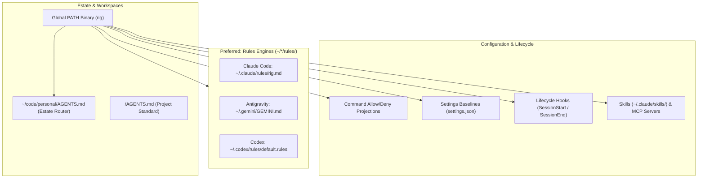

# Agent Surface Areas & Rig Integrations

Across the estate, developers and automated workflows employ multiple AI coding agents: Google Antigravity (AGY), Anthropic Claude Code, OpenAI Codex, OpenCode, and GitHub Copilot / Cursor.

To ensure consistent behavior, high reasoning budgets, and reliable execution without repetitive manual approval fatigue, `rig` integrates with these assistants across **seven distinct surface areas**.

______________________________________________________________________

## The Surface Areas



### 1. Rules Engines (`rules/`) — The Preferred Integration

Modern AI assistants support dedicated rule directories rather than relying solely on a single monolithic instruction file. **The rules approach is our preferred integration pattern across all tools**:

- **Two-Tier Isolation Architecture**:
  - **Tier 1 (File-Level Isolation)**: Because `rules/` is a modular directory rather than a monolithic file, each tool or domain owns its own dedicated file (e.g., `rig.md`, `python-style.md`, `git.md`). Adding, updating, or decommissioning a tool involves only that file, completely preventing write races, lock contention, or monolithic git merge conflicts.
  - **Tier 2 (Marker-Level Isolation)**: Inside any rule file (or shared instruction files like `~/.gemini/GEMINI.md`), deterministic HTML comment markers guarantee boundary isolation:
    ```markdown
    <!-- rig:global-context:begin -->
    ... managed block ...
    <!-- rig:global-context:end -->
    ```
    `rig` reads and writes strictly between its markers. Personal notes and other tools' sections outside the markers are preserved byte-for-byte across runs ([ADR 0015](../adr/0015-non-destructive-ai-assistant-configuration.md)).
- **Additive & Non-Shadowing**: Rules enrich agent knowledge without triggering legacy file fallback logic (e.g., avoiding the risk of a `CLAUDE.md` causing an agent to skip `AGENTS.md`).
- **Path-Scoped Activation**: Assistants like Claude Code support YAML frontmatter `paths: [...]` to conditionally load rules only when files matching specific globs are touched.

#### Surfaces & Harness Locations

| Assistant | Path | Scope | Integration Command |
|---|---|---|---|
| **Claude Code** | `~/.claude/rules/rig.md` | Global User | `rig devenv claude` |
| **Claude Code (Project)** | `.claude/rules/*.md` | Local Repository | Local repository conventions |
| **Google Antigravity (AGY)** | `~/.gemini/GEMINI.md` | Global User (`RULE[user_global]`) | `rig devenv agy` |
| **OpenAI Codex** | `~/.codex/rules/default.rules` | Global User | `rig devenv codex` |
| **Cursor** | `.cursor/rules/*.mdc` | Workspace / Project | Project configuration |

______________________________________________________________________

### 2. Instruction Standard (`AGENTS.md`)

`AGENTS.md` is the cross-tool open standard adopted across all personal repositories.

- **The 200-Rule Budget**: Frontier models follow 150–200 instructions consistently. Root instruction files are ruthlessly pruned to essential project identity, package manager, and critical commands ([docs/agents/agent-consistency.md](agent-consistency.md)).
- **Progressive Disclosure**: Detailed domain guidance lives in `docs/` or vault skills, referenced by pointers rather than dumped into the root context.
- **Estate Router**: `~/code/personal/AGENTS.md` is maintained by `rig devenv estate-rules` ([EstateRules.cs](../../src/Rig.Core/Devenv/EstateRules.cs)) to define universal rules across sibling checkouts.
- **Strict Anti-Shadowing Policy**: To keep a single source of truth, redundant per-tool instruction files (`CLAUDE.md`, `.cursorrules`, `GEMINI.md`, `.clinerules`) are strictly audited and excluded via `.gitignore` ([ADR 0017](../adr/0017-virtual-monorepo-estate-workspace-cli.md), [BespokeAgentFiles.cs](../../src/Rig.Core/Governance/BespokeAgentFiles.cs)).

______________________________________________________________________

### 3. CLI & Execution Environment (`PATH`)

`rig` is compiled and packaged as a global .NET tool under [ADR 0022](../adr/0022-csharp-is-rigs-primary-language.md):

- **Zero-Build Execution**: Installed to `~/.dotnet/tools/rig` and symlinked to `~/.local/bin/rig`. Because `~/.local/bin` is on system `PATH`, agents can invoke `rig` commands instantly without compiling or resolving Python virtual environments.
- **Deterministic Agent DX**: All estate commands offer `--json`, non-interactive flags (`--apply`, `--yes`), and standardized exit codes (see [docs/agents/rig-availability.md](rig-availability.md)).
- **Worktree In-Repo Development**: Developers inside a `rig` clone test local edits directly via `dotnet run --project src/Rig.Cli -- <command>`.

______________________________________________________________________

### 4. Settings & Configuration Baselines

Agent settings baselines are managed as non-destructive unions: existing user configurations, custom MCP servers, and credentials are never overwritten.

- **Claude Code**: `~/.claude/settings.json` is configured by `rig devenv claude` ([ClaudeBaseline.cs](../../src/Rig.Core/Devenv/ClaudeBaseline.cs)). Sets safe model defaults (`opus-5.5`), auto-compaction budgets (200k tokens), workflow guidelines, and suppresses automated attribution trailers.
- **OpenCode**: `~/.config/opencode/opencode.json` is configured by `rig devenv opencode` ([OpencodeDefaults.cs](../../src/Rig.Core/Devenv/OpencodeDefaults.cs)).

______________________________________________________________________

### 5. Command Policy Projections

Rather than forcing developers to repeatedly approve read-only or safe diagnostic commands, `rig` projects a unified policy into each harness's native schema ([ADR 0021](../adr/0021-projections-not-runtime-interposition.md)):

- **Source of Truth**: `config/cli-allowlists.json` defines exact commands, safe arguments, and denied patterns.
- **Harness Projections**: `NativeProjection.cs` compiles the allowlist/denylist into:
  - Claude Code: `permissions.allow` and `permissions.deny` in `~/.claude/settings.json`.
  - OpenCode: `permission` blocks in `~/.config/opencode/opencode.json`.
  - Antigravity: sandbox tool policies.

______________________________________________________________________

### 6. Lifecycle Event Hooks

Hooks allow headless monitoring and system prioritization without modifying the agent's internal reasoning loop:

- **Session End (`session-ledger.mjs`)**: Configured under `hooks.SessionEnd` in `~/.claude/settings.json`. Records session exit codes and reasons to `~/.claude/session-ends/<id>.json` for estate discovery and desktop managers without blocking the agent.
- **Session Start (`low-priority.mjs`)**: Configured under `hooks.SessionStart`. Sets the process and its child build tools to below-normal CPU priority (`nice 10` on macOS/Linux, `BELOW_NORMAL` on Windows) so agent compilation does not freeze the developer's foreground desktop.

______________________________________________________________________

### 7. Skills & MCP Servers

Modular capability extensions are maintained across all assistants:

- **Total Directory Mirroring**: Curated operational skills (`SKILL.md`) in `src/rig/skills/` are synced via `rig skills sync` ([ADR 0016](../adr/0016-plugin-based-skills-vendoring-and-mirroring.md)) to:
  - `~/.claude/skills/`
  - `~/.gemini/config/skills/`
  - `~/.codex/skills/`
  - `~/.config/opencode/skills/`
- **MCP Servers**: Standard local servers (such as `chrome-devtools` and the OpenKnowledge vault server) are registered natively with each assistant.

______________________________________________________________________

## Multi-Tool Marker Protocol

When `rig` writes into shared context files (such as `~/.claude/rules/rig.md`, `~/.gemini/GEMINI.md`, or `~/code/personal/AGENTS.md`), it strictly follows the **Marker Isolation Protocol**:

1. **Markers**:
   ```markdown
   <!-- rig:global-context:begin -->
   ... content managed by rig ...
   <!-- rig:global-context:end -->
   ```
1. **Missing File**: Rig creates the file with an appropriate header and the marker block.
1. **Existing File Without Markers**: Rig appends the marker block to the end of the file, preserving all pre-existing content.
1. **Existing File With Markers**: Rig updates *only* the slice between `begin` and `end`. Everything before `begin` and after `end` is preserved byte-for-byte.
1. **No Churn**: If the managed content is already identical, no write occurs and the file timestamp remains untouched.

This allows other estate tools, custom shell scripts, and personal developer rules to co-exist in the same files without race conditions or data loss.
