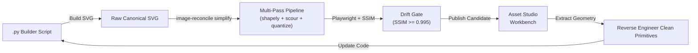
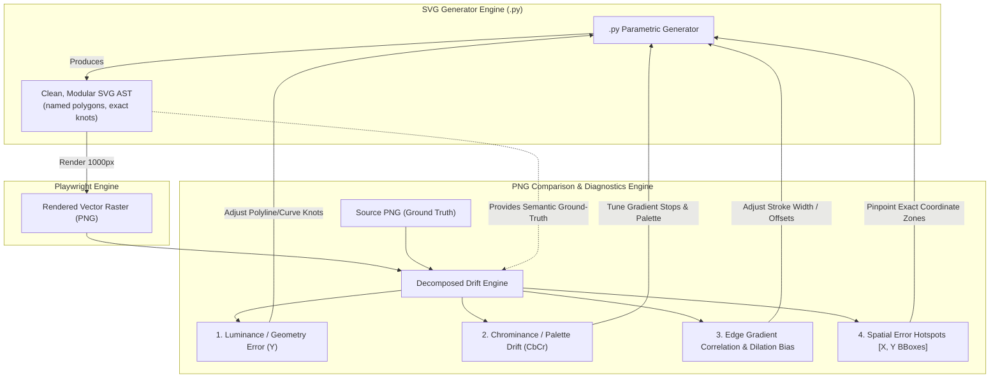

# SVG Simplification Pipeline & Python Reverse-Engineering Guide

> **Thresholds and asset layout are governed by [`brand-assets.md`](./README.md).**
> Where this document disagrees with it, that one is correct.

An industrial-grade, multi-pass SVG simplification architecture and iterative reverse-engineering workflow for `image_drift`.

---

## 1. Executive Overview & Philosophy

In high-assurance vector design, static hand-crafted or auto-traced SVGs are an anti-pattern: they accumulate point jitter, over-segmented Bézier curves, floating-point bloat, and unmaintainable hardcoded numbers.

Instead, the personal estate operates on a **Code-First Vector Architecture**:
1. **Programmatic Generation**: Assets are defined as parametric mathematical code in dedicated Python builder scripts (e.g. [`diamond_parquet_builder.py`](../../tools/image-drift/src/image_drift/diamond_parquet_builder.py) and [`labs_builder.py`](../../tools/image-drift/src/image_drift/labs_builder.py)).
2. **Multi-Pass Simplification**: Vector evolutions are scrubbed through a multi-tier pipeline combining geometric decimation (`shapely`), document scrubbing (`scour`), and viewBox-aware coordinate quantization. Every pass is pure Python, so the same input gives the same output on every machine.
3. **Closed-Loop Drift Gating**: Playwright renders the vector at 1000×1000 px and enforces strict regression bounds ($\text{SSIM} \ge 0.995$, $\text{RMSE} \le 1.0\%$).
4. **Iterative Reverse Engineering**: Clean geometric primitives and reduced node coordinates are reverse-engineered directly back into the `.py` builder file, making the refined asset reproducible in code.



---

## 2. Multi-Pass Simplification Architecture

The simplification engine operates across two distinct domains: **geometric/topological decimation** and **syntactic/document minification**.

```mermaid
flowchart TD
    In["Raw Canonical SVG"] --> P1["Pass 1: Document Scrubbing (scour)"]
    P1 -->|Clean Document AST| P2["Pass 2: Geometric & Topological Decimation"]
    
    subgraph P2Details["Pass 2: Geometry Engine"]
        P2A["Path Tokenizer & Subpath Classifier"]
        P2B["Closed Polygons: Shapely RDP (preserve_topology=True)"]
        P2C["Open Strokes: Shapely LineString RDP"]
        P2D["Bézier Curves: Curvature & Knot Decimation"]
        P2A --> P2B
        P2A --> P2C
        P2A --> P2D
    end
    
    P2Details --> P3["Pass 3: Syntactic Minification (ViewBox Quantize)"]
    P3 --> P4["Pass 4: Closed-Loop Drift Verification"]
    
    subgraph P4Details["Pass 4: Visual Regression Gating"]
        Render["Render Pre/Post SVGs via Playwright"]
        Metrics["Compute SSIM, PSNR, RMSE"]
        Gate{"SSIM >= 0.995\n& RMSE <= 1.0%?"}
        Render --> Metrics --> Gate
    end
    
    Gate -->|Yes| Out["Optimized Production SVG"]
    Gate -->|No (Drift Exceeded)| Backoff["Adaptive Tolerance Binary Backoff"]
    Backoff --> P2
    
    Out --> P5["Pass 5: Snapshot into Asset Studio (temp/variations/)"]
```

### Pass 1: Document Normalization & Scrubbing (`scour`)
- Strips redundant XML namespaces, doctypes, editor metadata (`<metadata>`, `<desc>`), comments, and unused `<defs>`.
- Prunes empty group wrappers (`<g></g>`) and collapses redundant transformation matrices.

### Pass 2: Geometric & Topological Decimation (`shapely` + Custom Curve Decimator)
Operates at the path level via [`ast_parser.py`](../../tools/image-drift/src/image_drift/simplifier/ast_parser.py) and [`geometric.py`](../../tools/image-drift/src/image_drift/simplifier/geometric.py):
- **Contour Classification**: Partitions path data by `M/m` into independent `SubPath` instances, determining whether each contour is an open stroke line or a closed polygon ring.
- **Polyline Decimation (Shapely)**:
  - Closed contours are mapped to `shapely.geometry.Polygon` (preserving internal cutout holes for compound paths) and simplified with Douglas-Peucker (`preserve_topology=True`).
  - Open contours are mapped to `shapely.geometry.LineString` and simplified without adding artificial closing lines or trailing `Z` commands.
- **Curvature-Aware Bézier Decimation**:
  - Tests cubic Bézier segments against the baseline chord ($p_0 \to p_3$). If control handles $p_1$ and $p_2$ deviate by less than $\epsilon$, the cubic curve is collapsed to a simple linear segment `L x y`.
  - Prunes redundant collinear line segments sharing tangent direction.
  - Preserves true curves (`C`, `S`, `Q`, `A`) with their original control handles, guaranteeing that organic shapes and typography never suffer polygonal faceting.

### Pass 3: Syntactic Minification & Coordinate Quantization
- **ViewBox-Relative Precision**: Dynamically computes precision based on canvas extents:
  $$\text{precision} = \begin{cases} 3 & \text{if } \max(W, H) \le 32 \text{ px (micro-icons)} \\ 2 & \text{if } \max(W, H) \le 128 \text{ px (standard icons)} \\ 1 & \text{if } \max(W, H) > 128 \text{ px (production brand marks)} \end{cases}$$
- **Delta Command Folding**: Evaluates the byte cost of absolute (`M/L/C`) vs relative (`m/l/c`) notation, selecting the shortest representation.
- **No SVGO pass.** It used to run an unpinned `npx -y svgo` and silently return its input when Node or the network was missing, so output varied by machine. It was removed rather than pinned.

### Pass 4: Closed-Loop Drift Verification
- Renders pre- and post-optimization SVGs to high-resolution PNGs (1000×1000 px) using Chromium via Playwright.
- Computes **SSIM**, **PSNR (dB)**, and **RMSE (%)**.
- If $\text{SSIM} < 0.995$ or $\text{RMSE} > 1.0\%$, initiates adaptive binary search on tolerance ($\epsilon \leftarrow \epsilon / 2$) until the visual error budget is satisfied.

### Pass 5: Asset Studio Publishing
- Automatically snapshots the optimized candidate into `temp/variations/<project>/` so it is instantly available for side-by-side, split-slider, and diff-heatmap inspection in the Asset Studio web workbench (`http://127.0.0.1:8092`).

---

## 3. CLI Command Reference

### Basic Simplification
```bash
uv run --project tools/image-drift image-reconcile simplify assets/parquet-source-generator/parquet-diamond.svg
```
Outputs `parquet-diamond.optimized.svg` sidecar alongside the original file and prints a comprehensive metrics table:

```
           [ SVG_SIMPLIFICATION_REPORT ]            
┏━━━━━━━━━━━━━━━━━━┳━━━━━━━━━━┳━━━━━━━━━━━┳━━━━━━━━┓
┃ Metric           ┃ Original ┃ Optimized ┃ Change ┃
┡━━━━━━━━━━━━━━━━━━╇━━━━━━━━━━╇━━━━━━━━━━━╇━━━━━━━━┩
│ File Size        │ 72,773 B │  40,083 B │ -44.9% │
│ Path Node Count  │    4,608 │     4,496 │  -2.4% │
│ Visual SSIM      │        - │    1.0000 │   PASS │
│ Visual PSNR      │        - │  58.28 dB │      - │
│ Visual RMSE      │        - │    0.122% │   PASS │
│ Active Tolerance │   ±0.5px │ ±0.5000px │      - │
└──────────────────┴──────────┴───────────┴────────┘
```

### Snapshotting Directly into Asset Studio
```bash
uv run --project tools/image-drift image-reconcile simplify assets/rtkelly-labs/rtkelly-labs.svg --snapshot
```

### In-Place Production Overwrite with Strict Quality Gating
```bash
uv run --project tools/image-drift image-reconcile simplify assets/rtkelly-labs/rtkelly-labs.svg \
  --in-place \
  --tolerance 0.75 \
  --min-ssim 0.998 \
  --max-rmse 0.5
```

---

## 4. The Iterative Reverse-Engineering Workflow

The primary objective of this system is to bridge the gap between **raw vector simplification** and **programmatic Python code**. 

Follow this 5-step loop to refine SVGs and reverse-engineer their geometric parameters back into `.py` builder scripts:

### Step 1: Run Simplification with Studio Snapshot
Run `image-reconcile simplify` on your current working SVG with `--snapshot`:
```bash
uv run --project tools/image-drift image-reconcile simplify assets/rtkelly-labs/rtkelly-labs.svg --snapshot -p rtkelly-labs
```

### Step 2: Inspect Visual Drift in Asset Studio
1. Open the Asset Studio workbench: `http://127.0.0.1:8092`.
2. Select your project in the header dropdown.
3. In `[ VARIATIONS_&_SNAPSHOTS ]`, click the newly captured `svg-optimized` candidate.
4. Toggle to `[ SPLIT_SLIDER ]` and drag the divider handle across complex curves and junctions.
5. Toggle to `[ DIFF_HEATMAP ]` to verify that pixel variance is near-zero (solid dark blue/black, no hot yellow spots).

### Step 3: Inspect the Simplified Path Primitives in Python
Use the `simplifier.ast_parser` API in a scratch script or interactive shell to inspect the simplified path coordinates:

```python
from pathlib import Path
from image_drift.simplifier.ast_parser import parse_path_d
import xml.etree.ElementTree as ET

svg_path = Path("assets/rtkelly-labs/rtkelly-labs.optimized.svg")
root = ET.fromstring(svg_path.read_text(encoding="utf-8"))

for elem in root.iter():
    if elem.tag.endswith("path") and "id" in elem.attrib:
        path_id = elem.attrib["id"]
        commands = parse_path_d(elem.attrib["d"])
        print(f"=== Path [{path_id}] ({len(commands)} commands) ===")
        for cmd in commands[:5]:
            print(f"  {cmd.command} {cmd.args}")
```

### Step 4: Port Simplified Coordinates into Python Builder Functions
Refactor the programmatic generator script to replace bloated manual coordinates with the clean, simplified primitives:

#### Before: Bloated / Jittery Coordinate Stream
```python
# Old manual coordinates with jitter:
dwg.add(dwg.path(
    d="M 512.0001 100.2312 L 512.4502 150.1209 L 512.9001 200.0101 L ...",
    fill="#22d3ee"
))
```

#### After: Clean Parametric Primitives in `.py` Builder
```python
# Reverse-engineered clean points:
points = [
    (512.0, 100.2),
    (512.5, 200.0), # redundant midpoint pruned
    (650.0, 320.0),
]
d_str = f"M {points[0][0]} {points[0][1]} " + " ".join(f"L {x} {y}" for x, y in points[1:]) + " Z"
dwg.add(dwg.path(d=d_str, fill="#22d3ee"))
```

### Step 5: Regenerate and Verify Fidelity
1. Re-run the builder script to produce the updated SVG:
   ```bash
   uv run --project tools/image-drift tools/image-drift/src/image_drift/labs_builder.py
   ```
2. Verify visual drift against the baseline:
   ```bash
   uv run --project tools/image-drift image-reconcile compare \
     --ref assets/rtkelly-labs/reference/01-original-concept.jpg \
     --svg assets/rtkelly-labs/rtkelly-labs.svg
   ```
3. Refresh Asset Studio to confirm that the programmatic SVG renders cleanly with zero visual drift.

---

## 5. Dual Co-Refinement: SVG Generation Engine & PNG Comparison Engine

The core architectural breakthrough of this system is the **symbiotic feedback loop between the SVG generation engine and the PNG raster comparison engine**:



### Why SVG Simplification Unlocks PNG Diff Reasoning

When an SVG is generated through naive auto-tracing, it produces an opaque soup of thousands of arbitrary coordinates, overlapping polygons, and sub-pixel jitter. In that state:
- Diff heatmaps are an undifferentiated red haze.
- You cannot tell whether an error stems from an edge misalignment, stroke dilation, antialiasing artifacts, or a color gradient mismatch.
- You cannot improve the PNG comparison engine because the vector input lacks semantic structure.

When the SVG generation engine is **simplified into clean parametric primitives**:
1. **Direct Semantic Attribution**: Every polygon, line, or arc in `.py` corresponds to a visible boundary in the rendered raster.
2. **Decomposed Error Channels**: Residual differences are cleanly separated into orthogonal physical causes:
   - **Luminance Error ($Y$)**: Pure structural contour displacement and vertex misalignment.
   - **Chrominance Error ($CbCr$)**: Color palette, lighting, and gradient stop mismatch independent of shape.
   - **Boundary Dilation Bias**: Quantifies whether vector features are systematically oversized (+bias, dilated/too thick) or undersized (-bias, eroded/too thin) relative to the raster source.
   - **Edge Field Correlation**: Pearson correlation of Sobel gradient vectors along high-frequency contours.
3. **Spatial Error Hotspots**: Pinpoints the exact coordinate bounding boxes `[X0..X1, Y0..Y1]` where error is concentrated, identifying the dominant failure mode (`GEOMETRY_EDGE` vs `CHROMATIC_COLOR`).

### Using the Decomposed Diagnostics CLI

Run the diagnostic engine to inspect the decomposed channels:
```bash
uv run --project tools/image-drift image-reconcile diagnose --project rtkelly-labs
```

Or evaluate a high-resolution canvas:
```bash
uv run --project tools/image-drift image-reconcile diagnose --project parquet-source-generator --size 1000
```

The report has two tables: whole-image drift (RMSE, PSNR, SSIM, luminance and chrominance error, edge correlation, contour bias) and the worst localised hotspots, each with its dominant cause. Run the command above to see one.

You can also append `--decompose` (`-D`) to standard comparison:
```bash
uv run --project tools/image-drift image-reconcile compare --project rtkelly-labs --decompose
```

### The 3-Phase Iterative Co-Refinement Loop

1. **Phase 1: Structural Geometry Alignment**
   - Run `image-reconcile diagnose`.
   - Check `Luminance Error (Y)` and `Boundary Contour Bias`.
   - If `Boundary Contour Bias > +0.10`, reduce stroke widths or contract outer vertex coordinates in the `.py` builder.
   - Cross-reference `LOCALIZED_ERROR_HOTSPOTS` with vertex coordinates in `.py` to eliminate geometric overshoots.
   - **Target**: Luminance RMSE $\le 1.0\%$, Edge Correlation $\ge 90\%$, Boundary Bias near $0.0$.
2. **Phase 2: Photometric Color Calibration**
   - Check `Chrominance Error (CbCr)` and `Color/Geometry ratio`.
   - If chrominance error dominates, adjust `<linearGradient>` stops, opacity, or hex values in the `.py` builder.
   - **Target**: Chrominance RMSE $\le 0.5\%$.
3. **Phase 3: Syntactic & Structural Simplification**
   - Run `image-reconcile simplify --snapshot` to run Scour and quantization and verify with Playwright that SSIM remains $\ge 0.995$.
   - Reverse-engineer any simplified primitives back into the `.py` builder to keep code minimal and clean.

---

## 6. Architectural Invariants & Estate Conventions

1. **Deterministic Regeneration**: Every production SVG in `assets/<project>/` must be 100% reproducible by executing its corresponding Python builder module.
2. **Drift Bounds**: Production SVGs must maintain $\text{SSIM} \ge 0.990$ and $\text{RMSE} \le 2.0\%$ against their approved reference baselines.
3. **Reference Verification**: Any simplified asset must pass the `simplify` drift gate and be scored with `image-reconcile compare` against its approved reference.
4. **Git Hygiene**: Intermediate candidate iterations and experimental variations must remain in `temp/variations/` (git-ignored) and never be committed to source control. Only clean, final production cuts live in `assets/<project>/`.
5. **Strict CSV Derivation of Production Cuts**: The production cuts folder for every brand asset project (`assets/<project>/production-cuts/`) **MUST ALWAYS** be derived strictly from `production-cuts.csv` situated within that folder. All production distribution cuts (`.png`, `.svg`, `.ico`) reside in `production-cuts/`, and any unlisted file in that directory is strictly ignored by catalog indexers and export pipelines to prevent clutter and duplicate conventions.


