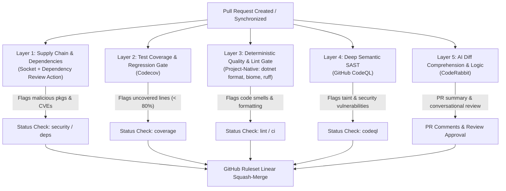

# Open Source Code Review Tooling: Analysis, Selection Matrix & Adoption Path

This document provides a comprehensive evaluation of automated code review, static analysis, SAST, and supply chain tooling that offer **100% free tiers for public open-source repositories**. It defines the chosen multi-layer review architecture, explains why these tools are strictly complementary, and details the automated adoption path enforced by `repo-governance` across the personal estate.

---

## 1. Context & Operational Philosophy

The virtual monorepo estate (`/Users/ryankelly/code/personal`) maintains multiple public open source projects across two primary GitHub namespaces:
- **`rtkelly-labs`**: Public libraries and design systems ([`design-system`](https://github.com/rtkelly-labs/design-system), [`Parquet.SourceGenerator`](https://github.com/rtkelly-labs/Parquet.SourceGenerator), [`Parquet.TypeProvider`](https://github.com/rtkelly-labs/Parquet.TypeProvider)).
- **`rtkelly13` & associated orgs**: Developer utilities, reference architectures, and packages ([`Resultful`](https://github.com/Resultful/Resultful), [`blog`](https://github.com/rtkelly13/blog), [`shared-utilities`](https://github.com/rtkelly13/rig)).

Across these repositories, the tech stack spans:
- **C# / .NET 10** (Source generators, Roslyn analyzers, railway-oriented programming primitives)
- **F#** (Type providers, compile-time schema inference)
- **TypeScript / React** (Component libraries, visual regression testing, Next.js)
- **Python 3.13+** (Estate CLI orchestration, AST parsing, repo governance)

### The Invariant
Every tool chosen must:
1. **Provide a zero-cost tier for public open source projects** with no trial expiration or artificial LOC limits on public repos.
2. **Minimize human administrative overhead** through declarative configuration managed by `shared-utilities`.
3. **Avoid review noise and alert fatigue** by assigning each tool a mutually exclusive, non-overlapping responsibility in the pull request lifecycle.

---

## 2. Evaluation & Selection Matrix

The following matrix compares tools evaluated for open-source PR governance:

| Tool | Category / Layer | OSS Pricing Model | Integration Vector | Tech Stack Fit (.NET, F#, TS, Python) | Selection Status | Strategic Justification & Trade-offs |
| :--- | :--- | :--- | :--- | :--- | :---: | :--- |
| **CodeRabbit** | AI Semantic & Logic Review | **100% Free** for all public repositories (unlimited reviews) | GitHub App | **High**: Excellent AST + diff analysis across TS, C#, Python, Markdown | **CHOSEN** | Best-in-class signal-to-noise ratio. Provides high-level PR walkthroughs, flags concurrency and edge-case bugs, and supports interactive chat on PR comments. Configured via in-repo `.coderabbit.yaml`. |
| **GitHub CodeQL** | Deep SAST & Semantic Taint Tracking | **100% Free** for all public repos (GitHub Advanced Security) | Native GitHub Action | **High**: Built-in support for C#, TypeScript/JavaScript, Python | **CHOSEN** | Compiler-level semantic analysis for CWEs, injection, and tainted dataflows. Runs natively in GitHub Actions with zero 3rd-party SaaS app permissions required. |
| **Socket** | Supply Chain Security | **100% Free** for open source repositories | GitHub App | **High**: Deep analysis of npm, PyPI, and NuGet package diffs | **CHOSEN** | Detects malicious package scripts, typo-squatting, unmaintained dependencies, and permission risks directly in dependency diffs before merge. |
| **DeepSource** | Static Analysis & Continuous Autofix | **100% Free** for open source repositories | GitHub App (`deepsource-io`) | **High**: Python, TypeScript/JavaScript, Go, Secrets | **CHOSEN (Web/Python)** | Webhook-based cloud execution consuming 0 CI runner minutes. Catches bug risks, performance issues, and provides 1-click PR Autofix. |
| **JetBrains Qodana** | Deep Semantic & Architectural Analysis | **100% Free** Community Linters (`qodana-cdnet`) | GitHub Action | **Exceptional**: Powered by JetBrains **ReSharper** (.NET) | **CHOSEN (.NET)** | Headless ReSharper engine running in CI. Catches deep C# memory/LINQ allocations, async/await anti-patterns, and exports SARIF to GitHub Code Scanning. |
| **GitHub Dependency Review** | License & Vulnerability Scanning | **100% Free** for all public repositories | Native GitHub Action | **High**: Evaluates lockfiles across NuGet, npm, PyPI | **COMPLEMENTARY** | Native, zero-setup action (`actions/dependency-review-action`) that blocks PRs introducing known CVEs or disallowed open-source licenses. Runs seamlessly alongside Socket. |
| **Codecov** | Test Coverage & Delta Gate | **100% Free** for open source repositories | GitHub App + Action | **High**: Ingests Cobertura, lcov, and coverage.py formats | **CHOSEN** | Gold standard for PR coverage comments. Enforces patch coverage targets (e.g. 80% on newly added lines) to prevent untested code regressions. |
| **SonarCloud** | Static Analysis & Quality Gate | Free for OSS, but high onboarding friction | GitHub App + Action | **Low-Medium**: No automatic analysis for .NET; requires manual setup | Excluded / Dropped | Lacks a working direct GitHub App installation link (404), requires manual organization registration on external SaaS portal (`sonarcloud.io`), requires `SONAR_TOKEN` repository secrets, and cannot auto-analyze compiled .NET/C#. Replaced by project-native linters (`dotnet format`, `biome`, `ruff`). |
| **Qodo PR-Agent** | AI Code Review | Open Source (Apache 2.0); self-host or free SaaS tier | Action / App | **Medium**: Good broad support, slightly more verbose | Alternative | Excellent open-source alternative to CodeRabbit, but requires managing self-hosted LLM keys or more active prompt tuning. |
| **MegaLinter** | Aggregated Linters | 100% Free & Open Source | GitHub Action | **High**: Bundles 100+ linters for every language | Complementary | Powerful for catch-all linting, but heavy runner runtime (3-6 minutes per PR) compared to fast project-native linters (`ruff`, `dotnet format`, `biome`). |
| **Semgrep OSS** | Fast AST Pattern Scanning | 100% Free engine + Community Registry | GitHub Action / CLI | **Medium**: TS & Python excellent; C# community rules smaller | Complementary | Extremely fast custom AST linting. Can be added as a targeted fast-path check in CI workflows where CodeQL is too slow. |
| **Sourcery** | Python/JS Refactoring AI | Free for open source repos | GitHub App | **Low-Medium**: Focused primarily on Python & JS/TS | Alternative | Strong for Python refactoring suggestions, but narrow language breadth for C#/.NET and F# repositories. |
| **Coveralls** | Test Coverage Delta | Free for public repos | GitHub App + Action | **High** | Alternative | Lightweight and reliable, but Codecov offers superior patch coverage visual flags and finer-grained threshold gating. |
| **Snyk** | Vulnerability & Dependency Scan | Free for open source (unlimited scans) | GitHub App / Action | **High** | Alternative | Robust, but redundant when pairing GitHub CodeQL + Dependency Review Action + Socket. |

---

## 3. The Complementary Defense-in-Depth Model

A critical failure mode of automated code review is **alert fatigue**: having multiple tools comment on the same syntax error or post duplicate PR comments.

The chosen tools form a strict **five-layer defense pipeline** where each tool operates on a completely different level of abstraction:



### Why These Tools Are Strictly Complementary

1. **Supply Chain (Socket & Dependency Review) vs. SAST (CodeQL)**:
   - *Dependency Review* inspects *what packages you are importing* (transitive dependencies, CVE advisories, malicious install scripts).
   - *CodeQL* inspects *how your code handles data* (taint tracking from user input into SQL, command execution, or memory allocation).

2. **Deterministic Rules (Native Linters) vs. AI Reasoning (CodeRabbit)**:
   - *Native Linters (`dotnet format`, `biome`, `ruff`)* enforce strict mathematical style, formatting, and AST compiler warnings locally and in CI with zero network latency and zero third-party SaaS tokens.
   - *CodeRabbit* reads the developer's intent and diff context. It spots subtle business logic errors, race conditions, unhandled exceptions in asynchronous workflows, and API design ergonomics that static rules cannot perceive.

3. **Patch Coverage (Codecov)**:
   - *Codecov* specializes in **PR Patch Coverage**: answering *"Did this PR author write tests for the specific lines they just changed?"* This prevents code quality regressions without requiring the author to pay down historical technical debt across the entire legacy repository.

---

## 4. Governance Tooling Integration (`shared-utilities`)

Project governance in `shared-utilities` automates the adoption and maintenance of this stack across the estate, removing manual setup friction.

### 1. Central Declaration in `config/repo_policies.json`

All third-party review integrations are declared under the `github_apps` schema:

Each app names its install URL, an optional in-repo `config_template`, and per-account scoping (`required`, `all_repos`, `disallow_repos`); see `github_apps` in [`config/repo_policies.json`](../../config/repo_policies.json). `repo-governance apps --help` covers the audit and enforcement.

### 2. Standardized Status Check Names

Branch protection rulesets require check names from the canonical lexicon in [`CheckNames.cs`](../../src/Rig.Core/Governance/CheckNames.cs):
- `ci`: The umbrella PR aggregate check.
- `security`: SAST (CodeQL) and dependency scans.
- `coverage`: Codecov patch coverage gate.
- `lint`: In-repo formatting and static analysis (`dotnet format`, `biome`, `ruff`).

---

## 5. Path to Adoption for Public Repositories

Adopting this suite across all public repositories follows a structured, progressive four-phase pipeline:

```text
Phase 1 (Zero-Friction Actions) ──> Phase 2 (Config Alignment) ──> Phase 3 (App Scoping) ──> Phase 4 (Ruleset Gates)
```

### Phase 1: Native GitHub Actions (CodeQL & Dependency Review)
*Zero SaaS app authorizations required. Purely repository workflow commits.*

1. **Deploy CodeQL SAST Workflow** (`.github/workflows/codeql.yml`):
   Runs semantic analysis on `pull_request` and push to `main` for `.NET`, `TypeScript`, and `Python`.
2. **Deploy Dependency Review Workflow** (`.github/workflows/dependency-review.yml`):
   Blocks pull requests introducing packages with severe CVEs or incompatible licenses.

### Phase 2: In-Repo Configuration Alignment
*Standardized configuration files deployed via `repo-governance`.*

Run the governance CLI to verify or deploy canonical configuration baselines:
```bash
# Audit or enforce in-repo configurations across an organization or the estate
uv run repo-governance apps --org rtkelly-labs --enforce --review-tools
```

This ensures the repository root contains:
1. **`.coderabbit.yaml`**: Configured with concise tone, auto-review enabled, draft skipping, and noise filters on build artifacts.
2. **`codecov.yml`**: Configured with an 80% patch coverage target (5% threshold), a 1% project threshold, and a diff/flags/files comment layout.
3. **`.deepsource.toml`**: Configured with language-specific analyzers (Python, JavaScript/TypeScript, C#) and universal secret scanning.
4. **`qodana.yaml` & `.github/workflows/qodana.yml`**: Configured for .NET repositories using JetBrains' `qodana-cdnet` community linter (selected via the action's `args: --linter,...` input) to emit SARIF to GitHub Code Scanning.

### Phase 3: GitHub App Installation & Repository Scoping
*One-time human authorization per GitHub organization; programmatic scoping via CLI.*

1. **One-Time Installation**: Organization admin visits the install URLs generated by `repo-governance apps`:
   - [CodeRabbit Installation](https://github.com/apps/coderabbitai/installations/new)
   - [Codecov Installation](https://github.com/apps/codecov/installations/new)
   - [Socket Security Installation](https://github.com/apps/socket-security/installations/new)
   - [DeepSource Installation](https://github.com/apps/deepsource-io/installations/new)
2. **Programmatic Scoping**:
   Whenever a new repository is added to the estate or migrated to `rtkelly-labs`, run:
   ```bash
   uv run repo-governance apps --org rtkelly-labs --enforce
   ```
   This automatically calls the GitHub API (`PUT /user/installations/{id}/repositories/{repo_id}`) to connect the repository to all required apps without clicking around the GitHub web settings.

### Phase 4: Ruleset & Branch Protection Enforcement
*Gating PR merges on automated reviews.*

Once the workflows and apps are active:
1. Verify CI status check names match the estate lexicon:
   ```bash
   uv run repo-governance check-names --org rtkelly-labs
   ```
2. Enforce GitHub branch protection rulesets and squash-merge policies:
   ```bash
   uv run repo-governance enforce --org rtkelly-labs
   ```

---

## 6. Operational Runbook & CLI Cheatsheet

### Audit Installed Apps & Permissions
```bash
# Check GitHub Apps status across rtkelly-labs
uv run repo-governance apps --org rtkelly-labs --audit

# Check GitHub Apps status across personal account
uv run repo-governance apps --org rtkelly13 --audit
```

### Sync Missing Repository Connections
```bash
# Preview API mutations to add repos to installed apps
uv run repo-governance apps --org rtkelly-labs --enforce --dry-run

# Connect missing repos to declared GitHub Apps
uv run repo-governance apps --org rtkelly-labs --enforce
```

### Deploy In-Repo Tool Configurations
```bash
# Audit and create .coderabbit.yaml and codecov.yml
uv run repo-governance apps --org rtkelly-labs --enforce --review-tools
```

### Full Repository Hygiene & Ruleset Sync
```bash
# Complete governance synchronization for all public repos
uv run repo-governance status --org rtkelly-labs
uv run repo-governance enforce --org rtkelly-labs
```
