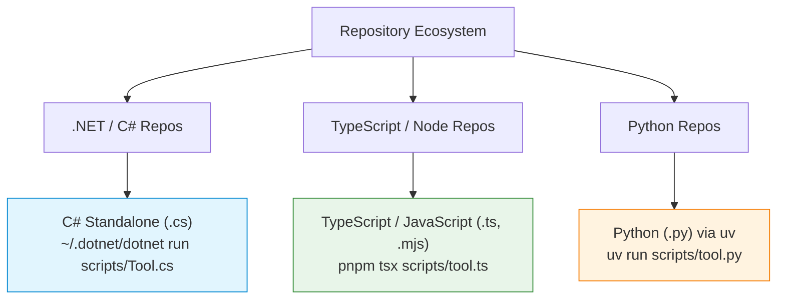
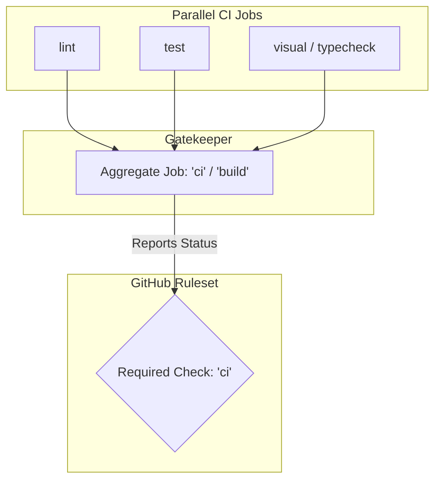
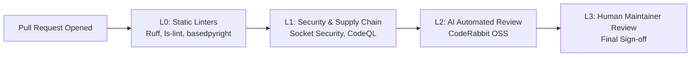
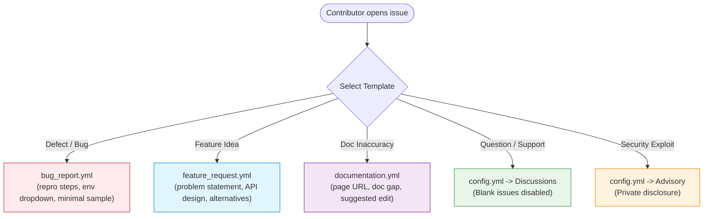

# Open Source Project Expectations

This document is the authoritative **hub specification and operational handbook** for establishing, configuring, governing, and maintaining open-source repositories across the personal (`rtkelly13/*`) and organization (`rtkelly-labs/*`) estates.

It captures the hard-won architectural patterns, failure modes, tooling invariants, and estate-wide automation standards developed across our polyglot codebases (.NET, TypeScript/React, Python).

---

## Table of Contents

1. [Architectural Philosophy](#1-architectural-philosophy)
2. [The 9 Foundational Repository Conventions](#2-the-9-foundational-repository-conventions)
3. [Script Language Policy & Filesystem Governance (`ls-lint`)](#3-script-language-policy--filesystem-governance-ls-lint)
4. [Git Strategy, Branching & Merge Automation](#4-git-strategy-branching--merge-automation)
5. [CI/CD Quality Gates & Pipeline Architecture](#5-cicd-quality-gates--pipeline-architecture)
6. [Automated Code Review & PR Defense](#6-automated-code-review--pr-defense)
7. [Community Health, Contributor Guides & Code of Conduct](#7-community-health-contributor-guides--code-of-conduct)
8. [Structured Issue Forms & Pull Request Templates](#8-structured-issue-forms--pull-request-templates)
9. [Statement of AI Utilisation Across Estate Projects](#9-statement-of-ai-utilisation-across-estate-projects)
10. [Estate-Wide Governance CLI & Alignment Workflows](#10-estate-wide-governance-cli--alignment-workflows)
11. [Repository Bootstrap & Verification Checklist](#11-repository-bootstrap--verification-checklist)

---

## 1. Architectural Philosophy

### Declarative Governance over Manual Memory
Developer discipline decays over time; manual checklists fail under pressure. Every architectural standard in an open-source repository must be:
1. **Machine-checkable** via static linters or CLI assertions.
2. **Hard-gated** in CI via pull request checks or GitHub rulesets.
3. **Centrally tracked** in estate configuration to detect drift across repos.

### The Zero-Noise Invariant
A repository should be strictly self-describing. Root folders must not become dumping grounds for scratch files, ad-hoc one-off scripts, machine-local state, or unindexed assets. If a file exists in the repository, its format, naming convention, and purpose are declared and validated.

### Deterministic Contributor & Agent Environment
AI coding assistants and external human contributors must operate within clear, mechanically bounded perimeters:
- Toolchains and script runtimes are constrained strictly to the repository's native stack.
- Working trees and temporary files are quarantined into gitignored directories.
- Automated code reviews provide immediate, objective feedback before human triage.

---

## 2. The 9 Foundational Repository Conventions

Every repository across the estate adheres strictly to the 9 Core Conventions codified in [`AGENTS.md`](../../AGENTS.md):

| # | Convention | Implementation & Gate | Why It Exists |
| :--- | :--- | :--- | :--- |
| **1** | **Squash Merge Only** | Enforced in GitHub repo settings and branch protection rulesets. | Eliminates messy branch histories, checkpoint commits, and rebase noise; keeps `main` bisectable. |
| **2** | **Delete Branch on Merge** | Enforced in GitHub repo settings (`delete_branch_on_merge: true`). | Keeps the remote repository clean and prevents stale tracking branches from cluttering remotes. |
| **3** | **Linear History** | Enforced in GitHub rulesets (`required_linear_history: true`). | Disallows merge commits; guarantees every commit on `main` represents a single squash or fast-forward. |
| **4** | **Direct Push Protection** | Enforced in GitHub rulesets (`enforcement: active`, direct pushes blocked). | All code enters `main` via PR with passing CI checks. (Force pushes permitted for emergency rollbacks). |
| **5** | **Local Temp & Worktree Containment** | Root `/temp/`, `.temp/`, and `/.worktrees/` strictly in `.gitignore`. | Quarantines scratch files, local SQLite/DuckDB databases, and agent worktrees from polluting git diffs. |
| **6** | **Gitignored Local TODO File** | Root `TODO.md` and `todo.md` strictly declared in `.gitignore`. | Allows human and agent developers to track in-flight tasks locally without accidental check-ins. |
| **7** | **Auto-Merge Enabled** | Enabled in repository settings (`allow_auto_merge: true`). | Allows clean, approved PRs to merge automatically as soon as required status checks pass. |
| **8** | **Pinned Action SHAs** | Enforced in CI via `ls-lint` / CI gate integrity linters. | Eliminates supply-chain tampering and unexpected upstream breaking changes in GitHub Actions. |
| **9** | **Script Language Policy** | Enforced by `.ls-lint.yml` (existence rules and extension allowlists). | Prohibits alien script runtimes (e.g. ad-hoc Python scripts in C# repos, bash/powershell everywhere). |

---

## 3. Script Language Policy & Filesystem Governance (`ls-lint`)

> [!IMPORTANT]
> Comprehensive rule mechanics and multi-case rules are detailed in [**Filesystem & Filename Governance (`ls-lint`)**](../repo-governance/filesystem-and-filename-governance.md).

### The "Alien Scripting" Problem
LLM agents frequently exhibit a strong bias toward generating quick `.py` or shell (`.sh`, `.ps1`) helper scripts to perform file operations, transformations, or data generation. In specialized ecosystems (such as .NET C# or TypeScript/React repos), this creates significant operational hazards:
- Introduces unmanaged runtime dependencies (requiring Python/Node runtimes on build machines that do not have them).
- Shell scripts fail cross-platform (e.g. bash scripts lacking POSIX parity on Windows; PowerShell failing on Linux/macOS runners).
- Fragmentation of domain logic into uncompiled, untyped sidecar files.

### Approved Script Stack by Ecosystem



- **.NET Repositories** (`Parquet.SourceGenerator`, `Iceberg.NET`, `Resultful`):
  - Scripts in `scripts/` MUST be C# files (`.cs`), executed via .NET 10 file-based scripting:
    ```bash
    dotnet run scripts/GenerateReport.cs
    ```
- **Node / TypeScript Repositories** (`design-system`, `mermaid-toolkit`):
  - Scripts MUST be `.ts`, `.js`, or `.mjs`, executed via `pnpm` or `node`.
- **Python Repositories** (`rig`, `ynab-budget-companion`):
  - Scripts MUST be `.py`, executed strictly via `uv run` (direct execution of `python` or `python3` is blocked).
- **Estate-Wide Rule**: Shell scripts (`.sh`, `.bash`, `.zsh`, `.ps1`, `.psm1`) are **strictly prohibited** in all repositories.

### Filesystem Governance via `ls-lint`
Every repository maintains a root `.ls-lint.yml` file asserting:
1. **Directory and file casing**: Enforces idiomatic naming (`kebab-case` for web, `PascalCase` for .NET source, `snake_case` for Python).
2. **Extension allowlists**: Restricts file extensions within specific directories (e.g. only `.cs` in `scripts/`).
3. **Explicit existence bans**: Declares `exists: 0` for banned extensions:
   ```yaml
   .dir:
     .sh: exists:0
     .ps1: exists:0
     .py: exists:0 # In non-Python repos
   ```

### Staged Rollout Pattern (`with: warn: true`)
When introducing filesystem or script constraints to legacy or active codebases:
1. **Stage 1 (Soft Rollout)**: Deploy `.ls-lint.yml` and the GitHub Action with `with: warn: true`. Violations are logged to CI logs with exit code 0 without failing builds.
2. **Stage 2 (Remediation)**: Port legacy scripts (e.g. converting bash setup scripts to C# or TypeScript).
3. **Stage 3 (Hard Gate)**: Remove `warn: true`, making CI fail on any unapproved file or extension.

---

## 4. Git Strategy, Branching & Merge Automation

> [!NOTE]
> Detailed stacking, worktrees, and conflict resolution patterns are in [**Git Strategy Guide**](../git/README.md).

### Linear History & Squash-and-Merge
- All PRs are merged via **Squash and Merge**.
- Commit titles follow Conventional Commits (`feat:`, `fix:`, `docs:`, `chore:`).
- The squash commit body captures the PR title and description, leaving a bisectable, clean record on `main`.

### GitHub Merge Queues vs Standard Auto-Merge

During our estate rollout across repositories like `Iceberg.NET`, we uncovered a critical operational difference between standard PR merges and GitHub Merge Queues:

```mermaid
sequenceDiagram
    autonumber
    actor Dev as Developer / Agent
    participant CLI as GitHub CLI (gh)
    participant GH as GitHub API
    participant MQ as Merge Queue
    participant CI as CI Runner (merge_group)

    alt Standard PR Auto-Merge
        Dev->>CLI: gh pr merge --auto --squash --delete-branch
        CLI->>GH: Enable auto-merge on PR
        GH-->>Dev: PR merges when CI passes; branch deleted
    else GitHub Merge Queue Enabled (e.g. Iceberg.NET)
        Dev->>CLI: gh pr merge --auto --squash --delete-branch
        CLI-->>Dev: ERROR: Cannot use -d or --delete-branch when merge queue enabled
        Dev->>CLI: gh pr merge --auto --squash (omit --delete-branch)
        CLI->>GH: Queue PR
        GH->>MQ: Enqueue PR
        MQ->>CI: Trigger workflow on 'merge_group'
        CI-->>MQ: Check passed ('ci' green)
        MQ->>GH: Squash and merge PR commit; delete branch automatically
    end
```

#### Key Invariants for Merge Queues
1. **Omit `--delete-branch` in CLI calls**:
   When a repository has a Merge Queue enabled, executing `gh pr merge <number> --auto --squash --delete-branch` will fail with:
   ```text
   Cannot use -d or --delete-branch when merge queue enabled
   ```
   The queue controller assumes ownership of the branch lifecycle; branch deletion must be configured in repository settings, not requested in the merge command.
2. **Workflow Trigger Parity (`merge_group`)**:
   Workflows enforcing required status checks MUST include `on: merge_group`:
   ```yaml
   on:
     push:
       branches: [main]
     pull_request:
       branches: [main]
     merge_group:
   ```
   If `merge_group` is missing, checks will not trigger on the temporary merge commit generated by the queue, causing the PR to hang indefinitely in the queue.

### Branch Protection Rulesets & GitHub Parameter Defaults
GitHub rulesets do not merge partial configurations; undeclared parameters are reset to GitHub defaults on update.
- Every parameter accepted by the GitHub Ruleset API must be declared explicitly in automation payloads (see [`docs/repo-governance.md`](../repo-governance/README.md)).
- Specifically, `require_extra_approval_for_unattributed_changes` must be set to `false` when automated agents or co-authored commits are active; otherwise, PRs become unmergeable deadlocks.

---

## 5. CI/CD Quality Gates & Pipeline Architecture

### The Single Required Check Gate Pattern (`ci` / `build`)

Branch protection should never bind directly to individual leaf jobs (e.g. `test-linux`, `test-windows`, `lint`, `typecheck`). When leaf jobs change or matrix configurations expand, branch protection requirements drift, causing unmergeable PRs.



#### Canonical Aggregate Job Implementation

Every other job is listed in the aggregate's `needs:`, and the aggregate runs with `if: always()` so a failed or skipped dependency fails it rather than skipping it. rig's own [`ci` job](../../.github/workflows/ci.yml) is a working example.

### Action SHA Pinning & Validation
- **Supply Chain Security**: All third-party GitHub Actions must be pinned to 40-character commit SHAs, never mutable tags (e.g. `@v2`, `@v4`).
- **Inline Documentation**: Every pinned SHA must include a trailing version comment:
  ```yaml
  uses: actions/checkout@11bd71901bbe5b1630ceea73d27597364c9af683 # v4.2.2
  uses: ls-lint/action@a87c5eb4fb26d7af1bd0adba203dd1e76f7e94eb # v2.3.2
  ```
- **Validation Requirement**: Never use synthetic or unverified SHAs. A non-existent commit SHA causes GitHub Actions runner initialization to fail immediately before any steps run:
  ```text
  Unable to resolve action ... unable to find version
  ```
- **Automated Gate Integrity**: Gate integrity tests (e.g. `CiGateIntegrityTests.cs` in `Parquet.SourceGenerator` or `check-governance.mjs` in `design-system`) fail CI if any action uses an unpinned tag or lacks a version comment.
- **Tooling**: `pinact` for the first pin, Dependabot's `github-actions` ecosystem to keep pins current, and `zizmor --offline` in CI to refuse an unpinned ref. See [repo-governance/action-pinning.md](repo-governance/action-pinning.md).

### Runner Ceilings (`timeout-minutes`)
To protect against deadlocks, hanging child processes, or unclosed browser sessions from consuming organization runner minutes:
- Every job must specify a strict `timeout-minutes` ceiling (default: 10–15 minutes).

### Multitarget Concurrency Isolation
In multitargeted codebases (e.g. .NET running target frameworks `net8.0` and `net9.0` simultaneously):
- Parallel test jobs must not race on shared or generated filesystem artifacts (e.g. API docs export or schema generation).
- **Rule**: Build and export shared artifacts in a dedicated setup step before initiating parallel matrix test executions.

---

## 6. Automated Code Review & PR Defense

> [!NOTE]
> Review app capabilities, permission scoping, and comparative matrices are documented in [**Open Source Code Review Tooling Adoption**](code-review-tooling-adoption.md).

Every PR across the estate passes through a progressive, automated review pipeline:



### Review Stack Overview
1. **L0: Static Linters & Typecheckers**: Fast in-runner gates (`ruff`, `basedpyright`, `ls-lint`, `ty`, `dotnet format`).
2. **L1: Supply Chain & SAST**:
   - **Socket Security**: Real-time dependency threat detection, typosquatting alerts, and license checks.
   - **GitHub CodeQL / Semgrep**: Static application security testing (SAST).
3. **L2: Automated AI Review (CodeRabbit)**:
   - High-level architecture and logic review.
   - Enforces repository-specific rules declared in `.coderabbit.yaml`.
   - **Automated Thread Resolution**:
     When CodeRabbit creates review threads, branches with required review gates cannot merge until threads are resolved. Maintainer automation can resolve threads programmatically using GitHub's GraphQL API:
     ```graphql
     mutation {
       resolveReviewThread(input: {threadId: "PRRT_kwDOM..."}) {
         thread {
           isResolved
         }
       }
     }
     ```

---

## 7. Community Health, Contributor Guides & Code of Conduct

> [!NOTE]
> Operational triage workflows, label sync, and template generators are covered in [**Open Source Governance & Triage Architecture**](open-source-governance.md).

Open-source projects must provide clear, welcoming, and rigorous guidance for contributors while protecting community well-being and project integrity.

### Comprehensive Contributor Guides (`CONTRIBUTING.md`)
Every managed repository includes a canonical `CONTRIBUTING.md` defining:
1. **Toolchain Purity & Setup**: Native installation commands (`uv sync` for Python, `pnpm install` for Node, `dotnet restore` for .NET) without requiring foreign runtimes.
2. **Branch Naming Conventions**: Standard branch prefixes:
   - `feat/<feature-name>` — New features or functional additions.
   - `fix/<bug-description>` — Bug fixes and regression repairs.
   - `docs/<doc-update>` — Documentation and specifications.
   - `chore/<maintenance-task>` — Tooling, dependencies, and hygiene.
3. **Linear Rebase Requirement**: Contributors must rebase their branches on `origin/main` before requesting review (`git fetch origin && git rebase origin/main`). Merge commits are rejected.
4. **Local Verification Standard**: Exact commands to run lint, formatting, type checking, and test suites locally before pushing.

### Contributor Covenant Code of Conduct (`CODE_OF_CONDUCT.md`)
All estate projects adopt the **Contributor Covenant v2.1**:
- **Pledge**: Creating an inclusive, accessible, and harassment-free community for everyone regardless of background, identity, or experience level.
- **Standards of Behavior**: Fostering empathy, constructive feedback, graceful apologies, and respect for differing viewpoints.
- **Enforcement & Reporting**: Clear reporting instructions directed to maintainer email (`ryan@ryankelly.dev`). All reports are reviewed confidentially, and community leaders have the responsibility to edit, reject, or remove contributions not aligned with the Code of Conduct.

### Coordinated Security Disclosure (`SECURITY.md`)
- Public issue trackers must **never** be used for suspected security vulnerabilities or zero-day exploits.
- Security disclosures must be submitted via **GitHub Private Vulnerability Reporting** or directly via email.
- The maintainer commits to acknowledging vulnerability reports within 48 hours and issuing timely fixes.

### Canonical Licensing & SPDX Headers
- Every repository root includes a standard OSI-approved `LICENSE` (MIT default, or Apache-2.0 / BSD-3 where indicated).
- Copyright notices specify `Ryan Kelly` (or authorized organization) with active year ranges.
- Source files carry standard SPDX headers in their file headers:
  ```csharp
  // SPDX-License-Identifier: MIT
  // Copyright (c) 2026 Ryan Kelly
  ```

### Label Taxonomy Parity
Standardized across all estate repositories via `repo-governance sync-labels`:
- **Type**: `type: bug`, `type: feature`, `type: performance`, `type: docs`, `type: maintenance`
- **Status**: `status: needs-repro`, `status: blocked`, `status: in-progress`
- **Community**: `good first issue`, `help wanted`
- **Impact**: `breaking-change`

---

## 8. Structured Issue Forms & Pull Request Templates

Issue intake and pull request reviews represent the primary operational boundary between repository maintainers, external contributors, and automated tooling. Unstructured markdown templates fail at scale: contributors delete headers, omit system architectures, skip reproduction steps, or open empty issues.

To ensure consistent data capture and zero-friction triage, all public estate repositories implement schema-validated **GitHub Issue Forms** (`.github/ISSUE_TEMPLATE/*.yml`) and a unified **Pull Request Template** (`.github/PULL_REQUEST_TEMPLATE.md`).

> [!TIP]
> Ongoing estate-wide expansion, dynamic parameter rendering, and template enhancements are tracked in issue [#367](https://github.com/rtkelly13/rig-archive/issues/367).

The other side of intake is filing well on projects we depend on: see
[Minimal Reproductions for Upstream Issues](minimal-reproductions.md) for building the smallest
failing program and preparing reports for projects that refuse AI-written ones.

### Architecture of Intake: Why Issue Forms Over Markdown
1. **Field-Level Validation**: Mandatory fields (such as reproduction steps and operating system) enforce completeness before an issue can be submitted (`validations: required: true`), preventing weeks of triage ping-pong.
2. **Deterministic Label Routing**: Forms automatically assign category labels (`labels: ["type: bug"]`, `labels: ["type: feature"]`) upon submission, enabling immediate routing in `repo-governance issue-triage`.
3. **Structured Form Controls**: Dropdowns (for supported operating systems and runtimes) eliminate ambiguous user entries, while rendered code blocks (`render: shell`, `render: json`) preserve formatting and stack traces.
4. **Blank Issue Elimination (`config.yml`)**: Blank issues are hard-disabled (`blank_issues_enabled: false`). General Q&A is routed to GitHub Discussions, while vulnerability reports are routed to GitHub Private Security Advisories.

### The Canonical Issue Form Suite



1. **`bug_report.yml` (Defect Reporting)**:
   - **Bug Description**: Concise statement of expected vs. actual behavior.
   - **Steps To Reproduce**: Required sequential list of reproduction steps.
   - **Minimal Reproducible Sample**: Rendered code/config fence providing a self-contained reproduction.
   - **Operating System Dropdown**: Closed selection (`macOS`, `Linux (Ubuntu / Debian)`, `Windows 11 / 10`, `Other`).
   - **Runtime & Toolchain Versions**: Capture of exact runtime versions (`Python 3.13`, `.NET 10`, `Node 22`).
   - **Relevant Log Output**: Formatted console output or stack traces.
2. **`feature_request.yml` (Enhancement Requests)**:
   - **Problem Statement**: Clear definition of the limitation or user friction ("Is your feature related to a problem?").
   - **Proposed Solution / API**: Proposed CLI syntax, C# interface, TypeScript types, or behavior.
   - **Alternatives Considered**: Exploration of alternative designs or workarounds.
   - **Contribution Willingness**: Opt-in checkbox indicating if the requester is willing to submit a PR.
3. **`documentation.yml` (Documentation Gaps & Fixes)**:
   - **Affected Documentation**: URL or relative file path to the affected guide.
   - **Description of Gap**: Inaccuracies, missing code samples, or stale version numbers.
   - **Suggested Correction**: Concrete markdown replacement.
4. **`config.yml` (Intake Guardrails)**:
   - Enforces `blank_issues_enabled: false`.
   - Contact links redirecting support requests to GitHub Discussions and vulnerabilities to Private Security Advisories.

---

### The Pull Request Template Architecture (`PULL_REQUEST_TEMPLATE.md`)

The pull request template serves as an objective contract and verification checklist between the author, the maintainer, and automated review bots (e.g. CodeRabbit).

Every pull request across the estate must satisfy this structured schema:

The template is [`templates/oss/PULL_REQUEST_TEMPLATE.md.jinja`](../../src/rig/repo_governance/templates/oss/PULL_REQUEST_TEMPLATE.md.jinja), synced into each repo by `repo-governance sync-templates`. Its sections: summary, linked issues, type of change, breaking-change migration, AI disclosure, and a verification checklist (rebased, tests, checks green, docs updated).

#### Key Review Invariants
- **Automated Issue Auto-Close**: Every PR addressing an open issue must include `Resolves: #<id>` or `Fixes: #<id>`. GitHub automatically closes the issue upon squash-merge into `main`.
- **Breaking Change Gate**: If `breaking-change` is checked, the author must explicitly provide backwards-compatibility analysis and migration instructions. Unexplained breaking changes are rejected.
- **AI Transparency Check**: Authors disclosing AI assistance confirm compliance with comprehension, license purity, and testing invariants.
- **Pre-Merge Rebase**: Enforces that the branch is rebased onto latest `main` prior to final merge, ensuring a linear history and avoiding merge queue conflicts.

---

## 9. Statement of AI Utilisation Across Estate Projects

Across our personal (`rtkelly13/*`) and organization (`rtkelly-labs/*`) repositories, we actively embrace generative AI and autonomous coding agents (including Claude, Gemini, Antigravity, GitHub Copilot, and Cursor) to accelerate development, explore architectural alternatives, and automate routine hygiene.

To balance rapid AI-assisted development with open-source rigor and trust, all repositories follow our codified AI policy (instantiated via `AI_POLICY.md` and repository README badges):

### 🔑 The Core Principle: 100% Human Accountability
**The human contributor or maintainer is 100% accountable for all submitted and merged work.**
- AI tools are powerful assistants, but an AI model cannot be named as the sole author or bear legal, moral, or architectural responsibility for a pull request.
- Every pull request, commit, and architectural decision is reviewed, understood, and defended by a human maintainer before entering `main`.

### Permitted vs. Prohibited AI Use
| Category | Practice | Policy |
| :--- | :--- | :---: |
| **Permitted** | Drafting implementations, algorithms, and refactorings | ✅ Welcomed |
| **Permitted** | Generating boilerplate, test suites, and mock datasets | ✅ Welcomed |
| **Permitted** | Researching API specifications, type signatures, and standards | ✅ Welcomed |
| **Permitted** | Polishing documentation, README guides, and XML doc comments | ✅ Welcomed |
| **Prohibited** | Autonomous bot PRs submitted without human review | ❌ Strictly Banned |
| **Prohibited** | Submitting unreviewed code ("AI slop") not understood by author | ❌ Strictly Banned |
| **Prohibited** | Introducing hallucinated packages, APIs, or foreign scripting runtimes | ❌ Strictly Banned |
| **Prohibited** | Ingesting copyrighted or copyleft code that breaches project licensing | ❌ Strictly Banned |

### Rigorous Quality Gates for AI-Generated Code
AI-generated code is not granted shortcuts; it is held to identical or higher standards than traditional code:
1. **Zero Type Soup**: In Python, code must strictly pass `basedpyright` with banned `Any`, no untyped dictionaries, and strict ratchet enforcement. In TypeScript, strict type safety without `any`. In C#, nullable reference types enabled and strict warning-as-error compilation.
2. **Deterministic Test Coverage**: All generated behaviors must be verified with comprehensive unit and integration tests across all supported runtimes.
3. **Filesystem Integrity**: Agents must adhere to the ecosystem script containment rules (no rogue `.py` or `.sh` dropped into .NET or Node projects).

### External Contributor Guidance
External community contributors are enthusiastically invited to use AI tools when contributing to our projects, subject to three conditions:
1. **Comprehension**: The contributor must personally understand and be able to explain the logic and trade-offs of the submitted code during PR review.
2. **Licensing Safety**: The contributor certifies that AI-generated code does not incorporate proprietary, confidential, or copyleft-licensed source code that conflicts with the repository's open-source license.
3. **Transparency**: If a substantial portion of a contribution was generated by AI, contributors are encouraged to disclose it in the PR description or include standard git trailers:
   ```text
   Co-authored-by: AI Assistant <noreply@anthropic.com>
   Assisted-by: Google Antigravity <noreply@google.com>
   ```

### Estate-Wide AI Policy Alignment (`AI_POLICY.md`)
Repositories enrolled in the `public_open_source` profile automatically deploy the canonical [`AI_POLICY.md`](../../src/rig/repo_governance/templates/AI_POLICY.md.jinja) and display the AI-assisted badge:

[](../AI_POLICY.md)

---

## 10. Estate-Wide Governance CLI & Alignment Workflows

All governance rules are declared centrally in [`config/repo_policies.json`](../../config/repo_policies.json) and enforced via the `repo-governance` CLI in `rig`.

```bash
# Check estate health and convention alignment
uv run repo-governance status

# Check specific repository alignment
uv run repo-governance status /path/to/repo

# Automatically align repository (syncs templates, .ls-lint.yml, .gitignore, workflows, AI_POLICY)
uv run repo-governance align /path/to/repo --apply

# Verify check names across all estate repos
uv run repo-governance check-names --all --strict

# Review open issues and pull requests across all repos
uv run repo-governance issue-triage --all
uv run repo-governance pr-triage --all
```

---

## 11. Repository Bootstrap & Verification Checklist

When establishing a new open-source repository or auditing an existing project, verify against this checklist:

### 1. Repository Settings & Branch Protection
- [ ] Primary branch is `main`
- [ ] Squash merge only enabled (`allow_squash_merge: true`, rebase/merge commits disabled)
- [ ] Auto-merge enabled (`allow_auto_merge: true`)
- [ ] Automatically delete head branches enabled (`delete_branch_on_merge: true`)
- [ ] Ruleset active on `main`:
  - [ ] Linear history required
  - [ ] Direct push blocked
  - [ ] Single required check required (`ci` or `build`)
  - [ ] Unattributed changes approval set to `false`

### 2. Filesystem & Script Hygiene
- [ ] Root `.gitignore` contains `temp/`, `.temp/`, `/.worktrees/`, `TODO.md`, `todo.md`
- [ ] `.ls-lint.yml` present and configured for ecosystem-native script paths
- [ ] Shell scripts (`.sh`, `.ps1`) strictly banned (`exists: 0`)
- [ ] Non-native script runtimes banned (e.g. `.py: exists: 0` in C# or Node repos)
- [ ] Local `pnpm dlx @ls-lint/ls-lint` passes cleanly

### 3. CI/CD Workflows
- [ ] GitHub Actions workflow under `.github/workflows/` (e.g. `ci.yml`)
- [ ] Workflow triggers on `push: [main]`, `pull_request: [main]`, and `merge_group` (if queue used)
- [ ] Single aggregate check job reporting stable name (`ci` or `build`)
- [ ] All action steps use 40-character commit SHAs with inline version comments
- [ ] Every job specifies `timeout-minutes` (e.g. 10 or 15)

### 4. Code Quality & Security Review
- [ ] Fast local linters / typecheckers configured (`ruff`, `basedpyright`, `pnpm check`, `dotnet format`)
- [ ] `.coderabbit.yaml` configured with repository tone and rules
- [ ] Socket Security app installed and active on repository
- [ ] Codecov or test coverage gate active (if applicable)

### 5. Community, Licensing & AI Governance
- [ ] Standard `LICENSE` file present at root (MIT default)
- [ ] Source files contain standard SPDX headers
- [ ] `CONTRIBUTING.md` present with toolchain, rebase, and test guidelines
- [ ] `CODE_OF_CONDUCT.md` present (Contributor Covenant v2.1 with reporting email)
- [ ] `SECURITY.md` present with private reporting instructions
- [ ] `AI_POLICY.md` present with transparency and human accountability statement
- [ ] `.github/ISSUE_TEMPLATE/` contains `bug_report.yml`, `feature_request.yml`, `config.yml`
- [ ] `.github/PULL_REQUEST_TEMPLATE.md` present
- [ ] Labels aligned with standard estate taxonomy via `repo-governance sync-labels`

---

## Related Documentation

- [**Filesystem & Filename Governance (`ls-lint`)**](../repo-governance/filesystem-and-filename-governance.md) — Directory casing rules, script containment, and exception allowlists.
- [**Open Source Governance & Triage Architecture**](open-source-governance.md) — Estate-wide issue forms, label synchronization, and triage automation.
- [**Repo Governance & Invariant Enforcement**](../repo-governance/README.md) — Check name drift guards, ruleset API parameter defaults, and hygiene audits.
- [**Code Review Tooling Adoption**](code-review-tooling-adoption.md) — In-depth evaluation of CodeRabbit, Socket, CodeQL, and Codecov.
- [**Git Strategy Guide**](../git/README.md) — Branching patterns, git worktrees, stacking, and merge mechanics.
- [**Agent Directive & Workspace Rules (`AGENTS.md`)**](../../AGENTS.md) — Authoritative workspace rules and execution constraints.
