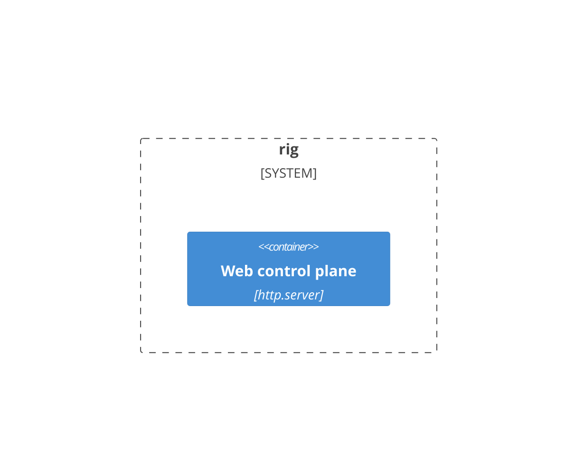

# C4 as an Open Knowledge Format bundle

**Question:** can the C4 model live as plain OKF documents, one diagram per document with notes under it,
and still give a documentation portal real *zoom in*, with several documents composing into one model?

**Answer:** yes, and the result is better than either part alone. OKF supplies identity, typing and
provenance, which C4 tools usually bury in a DSL. C4 supplies a level discipline, which makes OKF's link graph
checkable rather than just browsable.

| Piece | Where |
|---|---|
| Model, checks, composition | [`src/rig/c4_okf/`](../../src/rig/c4_okf/) (`bundle.py`, `mermaid_c4.py`, `graph.py`) |
| CLI | `uv run rig c4 check \| tree \| model \| expand CONCEPT ALIAS` |
| Viewer | `uv run rig web`, then **C4 architecture** in the sidebar, or `/c4/`. Set `RIG_C4_BUNDLE=<dir>` for another bundle |
| Derive from code | `uv run rig c4 derive dotnet REPO OUT [--parent CONCEPT:ALIAS] [--callgraph DIR] [--check]` (`derive.py`, `dotnet_scan.py`) |
| Sample bundles | [`rig/`](rig/): rig documenting itself, 8 hand-written concepts across all four levels. [`parquet-sourcegenerator/`](parquet-sourcegenerator/): one hand-written context view plus 17 views derived from the code. Switch between them with the viewer's bundle picker |
| Tests | [`tests/test_c4_okf.py`](../../tests/test_c4_okf.py), [`tests/test_c4_derive.py`](../../tests/test_c4_derive.py) |

## The shape

A concept is one markdown file. Its OKF `type` names its C4 level, its first ```` ```mermaid ```` block is the
diagram, and everything after the diagram is notes. A `## heading` named after an element's alias or label is
that element's note.

````markdown
---
type: C4 Container          # C4 Context=1, Container=2, Component=3, Code=4; also Landscape, Dynamic, Deployment
title: Rig — containers
resource: https://github.com/rtkelly13/rig
generated: { by: claude-code/opus-5-5, at: 2026-11-04 }
verified:  { by: ryan, at: 2026-11-05 }     # absent means nobody has checked it
---

## web
Notes for the `web` element. Notes can link to [decisions](web/decisions/no-node-at-runtime.md).
````

- **A zoom is a `$link`** on a C4 element, or `click X href` in a class or flowchart diagram at the code level.
  It is a plain OKF link, so any OKF consumer can still follow it.
- **An upward `$link` is a zoom out**, such as a code view linking back to its component view. It is
  classified as `zoom-out` and does not count as a zoom.
- **Body links are mentions.** They feed the "linked from" list but never the zoom tree.

## How documents compose

1. **The zoom graph is a DAG, not a tree.** `rig.db` is zoomed into from three views (containers,
   desktop-manager, web), so its schema is written once and reached three ways. `rig c4 tree` shows the
   repeats, and the `fan-in` finding reports them.
2. **An alias is one element across views.** `rig c4 model` merges every view into one element list (labels,
   kinds, views, zoom targets). Different labels for one alias raise `alias-conflict`.
3. **Expand inlines a child into its parent.** `rig c4 expand system-context rig` swaps the `rig` box for a
   boundary holding the container view. It drops the parent's relationships to `rig` that the child refines,
   and rebases the child's links to bundle-absolute paths so they still resolve. The viewer's `▸ expand`
   button does the same thing. The result is a diagram nobody wrote by hand, made from two that people did.
4. **Refinement is checked across levels.** If the parent draws `ryan → rig`, the container view must show
   `ryan` too. Otherwise the check raises `rel-unrefined`. This is the C4 rule "a zoomed view keeps its
   neighbours", made mechanical.

## Deriving the structure from code

Only the context view needs a person: who uses the system and what it touches outside its own repository.
Everything below it can be read straight from a .NET repository, without running .NET:

| Level | Source in the code | Relationships |
|---|---|---|
| Containers | each `.csproj` under `src/`, plus anything it references | `ProjectReference`; an analyzer reference is "checks at build"; an analyzer project is "loaded into the build" by the C# compiler |
| Components | the namespaces inside a project | two pathways, scored against each other (below) |
| Code | the types in a namespace, as a `classDiagram` | which types name each other; every type `click`s through to its file on GitHub at the commit |

**File details.** Each type in a code view carries its kind (`<<record>>`, `<<struct>>`, `<<enum>>`) and up to
eight public members. Members are only read from a file that declares exactly one type, so they are never
attributed to the wrong type. Its note gives the first sentence of its `/// <summary>`, its file, the directory
and the line count. Component notes have a file table: each file, any types it declares beyond the one its
name gives away, and its lines. Container notes give the target frameworks, the file count and the total lines.

**Two pathways, both kept.** Type references (a regex scan with comments, strings and `using`/`namespace`
lines stripped) see every mention but cannot tell a call from a signature. The call graph (the
`E:caller | callee` files from Parquet.SourceGenerator's Roslyn `scripts/CallGraph.cs`) is precise where it
resolves but misses delegates and dispatch. Each component view ends with a `## Derivation` note that lists
the relationships found on both, on references only, and on calls only. For Parquet.SourceGenerator: 11 on both, 5 on
references only, 0 on calls only. Legacy: 5 / 3 / 0. When the call-only column stays at 0, the cheap pathway is enough.

**Composition from the code itself.** Legacy compiles the modern generator's `Models`, `Parser`,
`Diagnostics` and `Emitter/Components` files in by `<Compile Include="..\**\*.cs" Link=...>`. Those namespaces
become one shared code view that both component views zoom into, so the fan-in is real and not drawn by hand.

**Refining a hand-written parent.** `--parent system-context:psg` copies the parent's neighbours of `psg`
(people, the compiler, NuGet) and their relationships into the container view. The boundary keeps the parent's
alias and label, so `rel-unrefined` and `alias-conflict` both pass. Edges the code cannot see (the emitted
code calls Parquet.Net, but no project references it) stay in the hand-written parent.

**Deterministic, so it is a staleness gate.** `generated.at` is the commit date and `resource` is the tree
URL at that commit, so re-deriving an unchanged repo writes nothing. `--check` exits 1 if any view is stale.
That is the CI hook: derived views can't silently drift, and hand-written views get `unverified`.

**It already found drift.** Parquet.SourceGenerator's hand-written `docs/architecture/overview.md` lists a
`Parquet.SourceGenerator.Attributes` project. That project no longer exists: the attributes live in Runtime.
The derived container view shows the real four projects.

To regenerate the sample from the rig root (the call graph is optional, and `<dir>` is any scratch directory):

```
PSG=../../rtkelly-labs/Parquet.SourceGenerator    # from code/personal/rig
(cd "$PSG" && dotnet run scripts/CallGraph.cs -- --out <dir>)
uv run rig c4 derive dotnet "$PSG" experiments/c4-okf/parquet-sourcegenerator \
  --parent system-context:psg --callgraph <dir>
```

The checked-in sample is derived from `main` at `348590d` (2026-11-04). `$PSG` must be checked out there, or
`--check` reports the views as stale.

The derived container view leaves out the parent's `Rel(csc, psg)`, because its own compiler-to-analyzer
relationships refine that one. `rel-unrefined` accepts the refinement.

Other languages would need only a new `*_scan.py`. A Python one would read `pyproject.toml` workspaces as
containers and modules as components, with `import` as the reference pathway.

## What OKF adds to C4

| OKF feature | What it does for C4 |
|---|---|
| `type` | Encodes the level, so `zoom-level` (did the zoom go one level deeper?) needs no schema of its own |
| Path as concept id | Stable identity for views. Links are files, so diffs, PRs and `git blame` all work |
| `generated` / `verified` | Per-diagram provenance. Agent-drawn diagrams are labelled as such, and `unverified` lists what no human has checked. This is the strongest argument for the format: diagrams go stale silently, and here the staleness becomes visible |
| `resource` | Ties a view to the code it describes, so the code level is a link out (as in IcePanel) and not a redrawn class diagram |
| Tolerating broken links | OKF requires consumers to tolerate broken links, so `rig c4 check` is a *producer-side* lint, like `lat.md`'s link check before an agent finishes |

## What doesn't map cleanly

- **Identity across documents.** Separately written views agree on an element only by alias. That works within
  one author's bundle; across teams it needs an explicit rule, such as aliases scoped by path or `resource` as
  the key. Decide this early, because it is the biggest risk. Structurizr and LikeC4 avoid it by being
  model-first.
- **The code level isn't C4 Mermaid.** Level 4 is a `classDiagram` or `erDiagram`, so the checks can read only
  its `click` links and not its structure. Linking out with `resource` is often the better choice.
- **Mermaid's own C4 support is weak.** Stock Mermaid ignores `$link` clicks (PR #7863 closed, tracker #7849
  open) and GitHub doesn't render C4 at all. **Pele** renders C4 links as real `<a>` elements and returns
  `links[]`, which is why it is the renderer here.
- **The Python side reads lines, not a grammar.** Pele parses properly in the browser; `mermaid_c4.py` reads
  only macros, braces and `$link`. Anything unusual (multi-line macros, `UpdateElementStyle`) is ignored and
  never misread.

- **Large, loosely linked code views lay out badly.** Pele does not wrap unconnected nodes, so a namespace of
  16 types that barely name each other (`Emitter.Components`) is one tall column at `direction LR` and one
  long row at `TB`. Scroll-zoom copes. A real fix is grouping by file or splitting the view.

## Prior art (independent survey)

- **Structurizr**: one model, many views; `!include`; implied relationships; inspections with configurable
  severity. Lite is end-of-life and the cloud service ends 2026-09-30.
- **LikeC4**: merges by fully qualified name with `extend`, has a CLI `validate`, an MCP server and
  `gen mermaid`. Model-first, like Structurizr.
- **IcePanel**: the code level is a link out. **Ilograph**: one element shown in many contexts.
- **New here**: docs-first with a *derived* model; a DAG of separately written diagrams checked for level and
  refinement; per-diagram provenance and freshness; nothing but plain markdown files.

## Rendering and theming

- The browser renders with a vendored **pele 1.13.0** (`static/vendor/pele.global.js`, MIT), so rig never
  runs Node, per the principle in [experiments/README.md](../README.md).
- `c4.css` maps the `--pele-*` variables onto the design system's `--ds-*` role tokens, so diagrams follow the
  page's level (midnight, sketch). The vendored mermaid-toolkit `retro-brutalist.css` is kept as reference only: linking it shadowed the mapping, because its `.dark .pele` rule is declared on the SVG itself.
- Pele is given the theme's font for text measurement. Without it, labels overflow their boxes.
- **Colour carries the level.** Each kind has one palette hue: person violet, system blue, container teal,
  component green, code orange. Elements are tinted by setting fill and stroke on pele's `pele-c4-*` node
  classes. Externals stay grey and dashed, so the eye lands inside the boundary. The level pill, the
  breadcrumb dots, the zoom-tree dots and each note's heading rule all use the same hue.
- **The map takes the room.** The diagram fills the stage and is centred (`preserveAspectRatio` is set on
  pele's SVG, and its inline `height: auto` is overridden). The zoom tree and the findings sit in a drawer that
  opens from the header. The notes column can be hidden.
- **Labels, not aliases.** Note headings, the selected-element panel and the "open in place" buttons show the
  element's drawn label. The alias is shown small beside it.

## Break-out recommendation

Split it in three, and only when a second consumer turns up:

1. **Pele theme → design system.** The `--pele-*` → `--ds-*` mapping in `c4.css` belongs in
   `@rtkelly13/design-system` as a `pele.css` per level, generated alongside `theme.css`. The design system
   then owns how diagrams look everywhere.
2. **Pele bundle and C4 link lint → mermaid-toolkit.** The toolkit already wraps pele. It should publish the
   browser build that rig vendors today, plus a `c4-link` lint rule that resolves `$link` against the file.
   That rule is the Node-side twin of `zoom-broken`. **A first version exists**, uncommitted, in the toolkit worktree
   `temp/c4-link-lint` (branch `feat/c4-link-lint`). `renderSvg` passes through pele's `links[]`;
   `lintMarkdown` takes an optional `linkExists` check, so it still touches no files; and `lintFiles` resolves
   `/x.md` from `cwd` and anything else from the linking file. On this bundle it agrees with `rig c4 check`:
   both pass clean, and both catch one deliberately broken `$link` at the same line.
3. **Bundle model and checks → a small package** (or a vault `okf-sync` step), once the vault or the docs
   portal wants `rig c4 check`. `src/rig/c4_okf/` has no imports from the rest of rig apart from
   `typed_json` and `typed_yaml`, and the web routes take a four-method `Responder` protocol, not rig's
   handler.

Until then it stays here: about 2,100 lines of Python (including about 750 for deriving from .NET), a 400-line viewer
script, and one hook in `server.py`.
