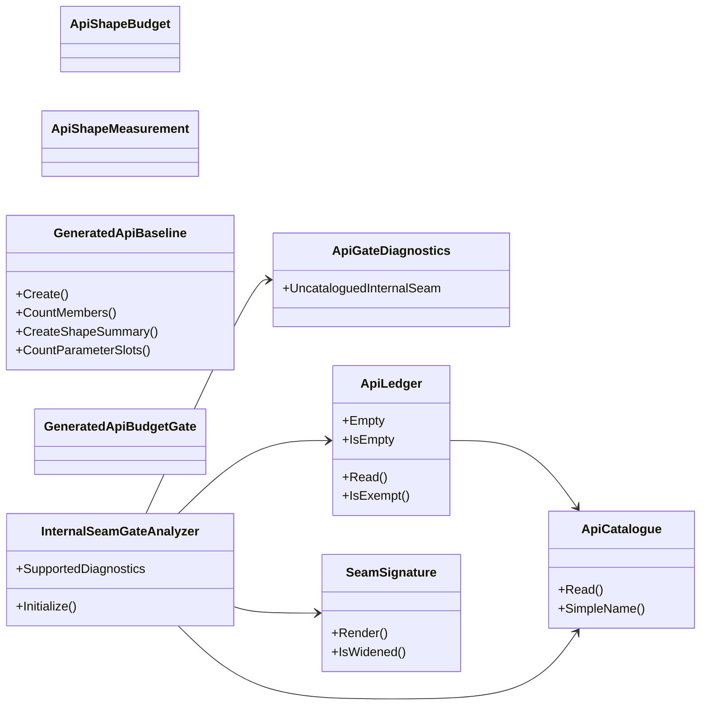

## ApiCatalogue

**class** · Reads a catalogue file — an emitted-API .api.txt baseline or src/api/seams.txt — into the set of signatures it declares.

[ApiCatalogue.cs](https://github.com/rtkelly-labs/Parquet.SourceGenerator/blob/348590d5b72c/tools/Parquet.SourceGenerator.ApiGates/ApiCatalogue.cs) in tools/Parquet.SourceGenerator.ApiGates/ · 88 lines

Public: `Read()`, `SimpleName()`

## ApiGateDiagnostics

**class** · The build-time API-contract rule.

[ApiGateDiagnostics.cs](https://github.com/rtkelly-labs/Parquet.SourceGenerator/blob/348590d5b72c/tools/Parquet.SourceGenerator.ApiGates/ApiGateDiagnostics.cs) in tools/Parquet.SourceGenerator.ApiGates/ · 45 lines

Public: `UncataloguedInternalSeam`

## ApiLedger

**class** · The escape hatch.

[ApiLedger.cs](https://github.com/rtkelly-labs/Parquet.SourceGenerator/blob/348590d5b72c/tools/Parquet.SourceGenerator.ApiGates/ApiLedger.cs) in tools/Parquet.SourceGenerator.ApiGates/ · 177 lines

Public: `Empty`, `IsEmpty`, `Read()`, `IsExempt()`

## ApiShapeBudget

**class** · A shape budget for an emitted model category.

[GeneratedApiBudgetGate.cs](https://github.com/rtkelly-labs/Parquet.SourceGenerator/blob/348590d5b72c/tools/Parquet.SourceGenerator.ApiGates/GeneratedApiBudgetGate.cs) in tools/Parquet.SourceGenerator.ApiGates/ · 333 lines

## ApiShapeMeasurement

**class** · A measured member and parameter count for a generated model.

[GeneratedApiBudgetGate.cs](https://github.com/rtkelly-labs/Parquet.SourceGenerator/blob/348590d5b72c/tools/Parquet.SourceGenerator.ApiGates/GeneratedApiBudgetGate.cs) in tools/Parquet.SourceGenerator.ApiGates/ · 333 lines

## GeneratedApiBaseline

**class** · Renders a signature-only baseline of the public API a generated source file emits.

[GeneratedApiBaseline.cs](https://github.com/rtkelly-labs/Parquet.SourceGenerator/blob/348590d5b72c/tools/Parquet.SourceGenerator.ApiGates/GeneratedApiBaseline.cs) in tools/Parquet.SourceGenerator.ApiGates/ · 672 lines

Public: `Create()`, `CountMembers()`, `CreateShapeSummary()`, `CountParameterSlots()`

## GeneratedApiBudgetGate

**class** · Gates emitted code generation against checked-in member and parameter budgets (src/api/emitted-api-budgets.txt).

[GeneratedApiBudgetGate.cs](https://github.com/rtkelly-labs/Parquet.SourceGenerator/blob/348590d5b72c/tools/Parquet.SourceGenerator.ApiGates/GeneratedApiBudgetGate.cs) in tools/Parquet.SourceGenerator.ApiGates/ · 333 lines

## InternalSeamGateAnalyzer

**class** · PARQAPI002 — fails the build when a member in src/ is widened past private without a line in src/api/seams.txt.

[InternalSeamGateAnalyzer.cs](https://github.com/rtkelly-labs/Parquet.SourceGenerator/blob/348590d5b72c/tools/Parquet.SourceGenerator.ApiGates/InternalSeamGateAnalyzer.cs) in tools/Parquet.SourceGenerator.ApiGates/ · 212 lines

Public: `SupportedDiagnostics`, `Initialize()`

## SeamSignature

**class** · Renders a member symbol into the one-per-line catalogue grammar used by src/api/seams.txt.

[SeamSignature.cs](https://github.com/rtkelly-labs/Parquet.SourceGenerator/blob/348590d5b72c/tools/Parquet.SourceGenerator.ApiGates/SeamSignature.cs) in tools/Parquet.SourceGenerator.ApiGates/ · 274 lines

Public: `Render()`, `IsWidened()`
