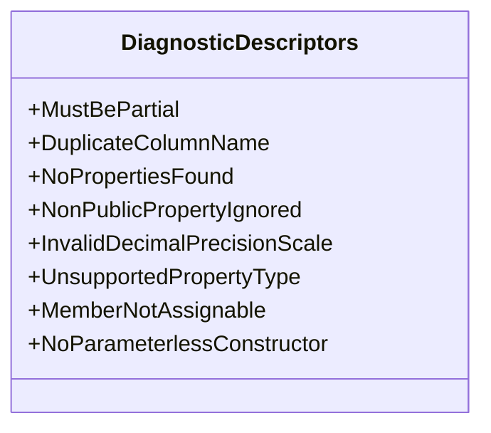

## DiagnosticDescriptors

**class** · Defines Roslyn diagnostic rules for compile-time validation of [ParquetSerializable] types.

[DiagnosticDescriptors.cs](https://github.com/rtkelly-labs/Parquet.SourceGenerator/blob/348590d5b72c/src/Parquet.SourceGenerator/Diagnostics/DiagnosticDescriptors.cs) in src/Parquet.SourceGenerator/Diagnostics/ · 331 lines

Public: `MustBePartial`, `DuplicateColumnName`, `NoPropertiesFound`, `NonPublicPropertyIgnored`, `InvalidDecimalPrecisionScale`, `UnsupportedPropertyType`, `MemberNotAssignable`, `NoParameterlessConstructor`
