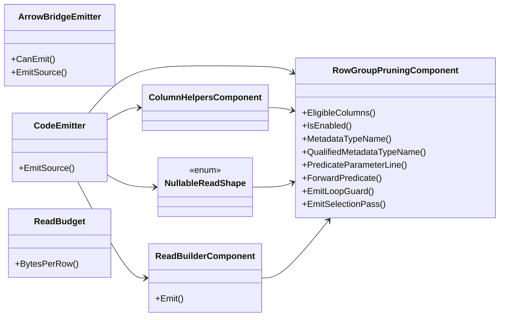

## ArrowBridgeEmitter

**class** · Emits the conditionally-generated Apache Arrow ingestion bridge ({Type}.Arrow.g.cs).

[ArrowBridgeEmitter.cs](https://github.com/rtkelly-labs/Parquet.SourceGenerator/blob/348590d5b72c/src/Parquet.SourceGenerator/Emitter/ArrowBridgeEmitter.cs) in src/Parquet.SourceGenerator/Emitter/ · 1101 lines

Public: `CanEmit()`, `EmitSource()`

## CodeEmitter

**class** · Emits high-performance C# extension classes targeting Parquet.Net v6 low-level primitives.

[CodeEmitter.cs](https://github.com/rtkelly-labs/Parquet.SourceGenerator/blob/348590d5b72c/src/Parquet.SourceGenerator/Emitter/CodeEmitter.cs) in src/Parquet.SourceGenerator/Emitter/ · 2397 lines

Public: `EmitSource()`

## ColumnHelpersComponent

**class** · Shared per-column helper methods for the v6 emitter (#552).

[ColumnHelpersComponent.cs](https://github.com/rtkelly-labs/Parquet.SourceGenerator/blob/348590d5b72c/src/Parquet.SourceGenerator/Emitter/ColumnHelpersComponent.cs) in src/Parquet.SourceGenerator/Emitter/ · 503 lines

## NullableReadShape

**enum** · The per-column value kinds the nullable read helpers dispatch on.

[ColumnHelpersComponent.cs](https://github.com/rtkelly-labs/Parquet.SourceGenerator/blob/348590d5b72c/src/Parquet.SourceGenerator/Emitter/ColumnHelpersComponent.cs) in src/Parquet.SourceGenerator/Emitter/ · 503 lines

## ReadBudget

**class** · Sizes what one row of a model costs the read path's pooled buffers, for the MaxAllocationBytes check emitted before each rental (#361).

[ReadBudget.cs](https://github.com/rtkelly-labs/Parquet.SourceGenerator/blob/348590d5b72c/src/Parquet.SourceGenerator/Emitter/ReadBudget.cs) in src/Parquet.SourceGenerator/Emitter/ · 44 lines

Public: `BytesPerRow()`

## ReadBuilderComponent

**class** · The generated read entry point and its reader struct (issues #217, #478).

[ReadBuilderComponent.cs](https://github.com/rtkelly-labs/Parquet.SourceGenerator/blob/348590d5b72c/src/Parquet.SourceGenerator/Emitter/ReadBuilderComponent.cs) in src/Parquet.SourceGenerator/Emitter/ · 379 lines

Public: `Emit()`

## RowGroupPruningComponent

**class** · Row-group predicate pushdown (issue #149).

[RowGroupPruningComponent.cs](https://github.com/rtkelly-labs/Parquet.SourceGenerator/blob/348590d5b72c/src/Parquet.SourceGenerator/Emitter/RowGroupPruningComponent.cs) in src/Parquet.SourceGenerator/Emitter/ · 423 lines

Public: `EligibleColumns()`, `IsEnabled()`, `MetadataTypeName()`, `QualifiedMetadataTypeName()`, `PredicateParameterLine()`, `ForwardPredicate()`, `EmitLoopGuard()`, `EmitSelectionPass()`
