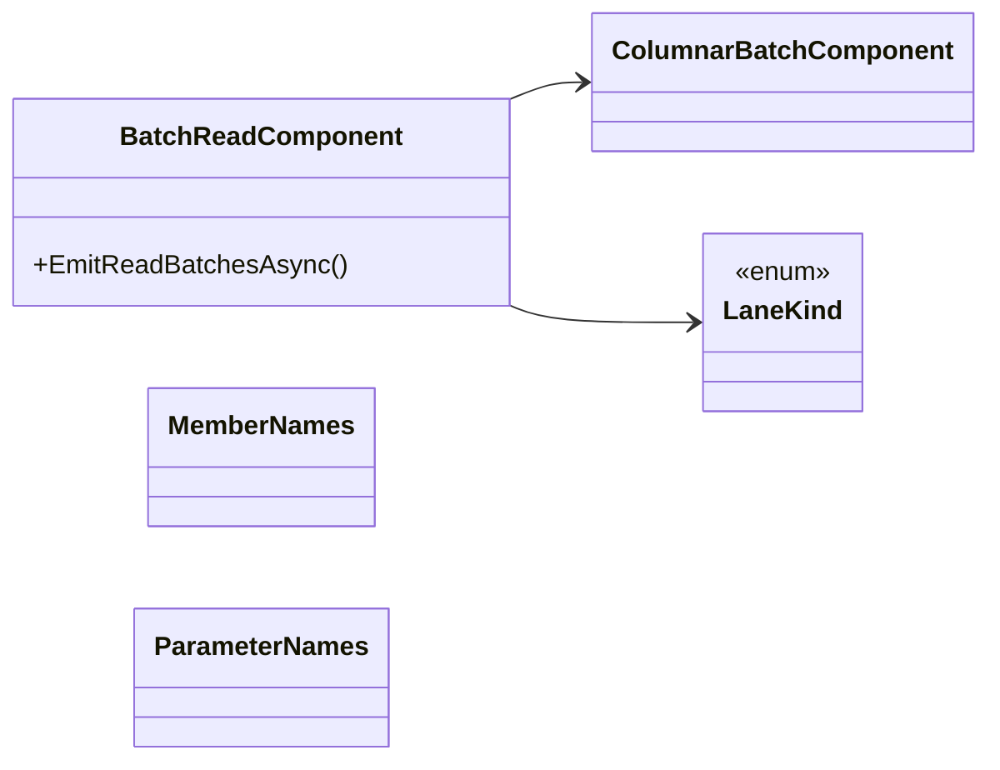

## BatchReadComponent

**class** · Emits the columnar read path (issues #147, #508): ReadBatchesCoreAsync, an async iterator that yields one &lt;Model&gt;Batch per row group without constructing a single domain obj…

[BatchReadComponent.cs](https://github.com/rtkelly-labs/Parquet.SourceGenerator/blob/348590d5b72c/src/Parquet.SourceGenerator/Emitter/Columnar/BatchReadComponent.cs) in src/Parquet.SourceGenerator/Emitter/Columnar/ · 579 lines

Public: `EmitReadBatchesAsync()`

## ColumnarBatchComponent

**class** · Emits the unified &lt;Model&gt;Batch (#137, #508): one per-model struct describing one row group as a set of column lanes, which is both what the columnar read path yields (see Ba…

[ColumnarBatchComponent.cs](https://github.com/rtkelly-labs/Parquet.SourceGenerator/blob/348590d5b72c/src/Parquet.SourceGenerator/Emitter/Columnar/ColumnarBatchComponent.cs) in src/Parquet.SourceGenerator/Emitter/Columnar/ · 1033 lines

## LaneKind

**enum** · The shape a column takes inside the batch, which decides how the read path decodes it and how the writer hands it to Parquet.Net.

[ColumnarBatchComponent.cs](https://github.com/rtkelly-labs/Parquet.SourceGenerator/blob/348590d5b72c/src/Parquet.SourceGenerator/Emitter/Columnar/ColumnarBatchComponent.cs) in src/Parquet.SourceGenerator/Emitter/Columnar/ · 1033 lines

## MemberNames

**class** · Every member name the batch struct declares, resolved in one pass (#384).

[ColumnarBatchComponent.cs](https://github.com/rtkelly-labs/Parquet.SourceGenerator/blob/348590d5b72c/src/Parquet.SourceGenerator/Emitter/Columnar/ColumnarBatchComponent.cs) in src/Parquet.SourceGenerator/Emitter/Columnar/ · 1033 lines

## ParameterNames

**class** · Parameter names for the batch constructors and the positional writer, which share one column-to-parameter binding.

[ColumnarBatchComponent.cs](https://github.com/rtkelly-labs/Parquet.SourceGenerator/blob/348590d5b72c/src/Parquet.SourceGenerator/Emitter/Columnar/ColumnarBatchComponent.cs) in src/Parquet.SourceGenerator/Emitter/Columnar/ · 1033 lines
