```mermaid
classDiagram
direction LR
class AllocationBudgetComponent {
  +ElementBytes()
  +FlatBytesPerRow()
  +FlatBytesPerValue()
  +BufferBytes()
  +EmitHelper()
}
class ArrowExtractionMode {
  <<enum>>
}
class ArrowLeafMapping
class ArrowMappingComponent
class BatchValidationComponent {
  +EmitRowGroupSizeResolution()
}
class BlockScope {
  <<struct>>
}
class BufferPoolComponent {
  +UsesWriteAllParts()
  +GetNonNullableBufferType()
  +GetBufferElementType()
  +GetWriteBufferElementType()
  +IsReferenceTypeBuffer()
  +EmitWriteRentals()
  +EmitSingleWriteReturn()
  +EmitWriteReturns()
}
class DecompressionGuardComponent {
  +Emit()
}
class DictionaryPageComponent {
  +EmitHelpers()
}
class EmittedText {
  +Ident()
  +Literal()
  +Comment()
  +XmlDoc()
}
class IndentScope {
  <<struct>>
}
class IndentedWriter
class PropertyMappingComponent {
  +IsSingleFieldBlittableStruct()
  +GetSingleFieldBufferElementType()
  +EmitArrayMaterialization()
  +GetWriteExpression()
  +GetReadExpression()
  +EmitObjectMaterialization()
  +EmitPropertyAssignments()
  +EmitReadTimeOnlyHelper()
}
class RowGroupLayoutComponent {
  +EmitLayoutProbe()
  +EmitIndexedLayoutProbe()
}
class SchemaComponent {
  +BoolLiteral()
  +GetFieldCreationExpression()
  +EmitStaticFields()
  +EmitSchema()
  +EmitResolveSchemaField()
  +EmitValidatePhysicalType()
  +EmitValidateColumnChunkBounds()
}
class StringDeduplicatorComponent {
  +HasStringProperties()
  +EmitStringDeduplicator()
  +EmitDeduplicatorDeclaration()
}
ArrowExtractionMode --> EmittedText
ArrowLeafMapping --> EmittedText
ArrowMappingComponent --> EmittedText
BufferPoolComponent --> IndentedWriter
PropertyMappingComponent --> IndentedWriter
SchemaComponent --> EmittedText
click AllocationBudgetComponent href "https://github.com/rtkelly-labs/Parquet.SourceGenerator/blob/348590d5b72c/src/Parquet.SourceGenerator/Emitter/Components/AllocationBudgetComponent.cs"
click ArrowExtractionMode href "https://github.com/rtkelly-labs/Parquet.SourceGenerator/blob/348590d5b72c/src/Parquet.SourceGenerator/Emitter/Components/ArrowMappingComponent.cs"
click ArrowLeafMapping href "https://github.com/rtkelly-labs/Parquet.SourceGenerator/blob/348590d5b72c/src/Parquet.SourceGenerator/Emitter/Components/ArrowMappingComponent.cs"
click ArrowMappingComponent href "https://github.com/rtkelly-labs/Parquet.SourceGenerator/blob/348590d5b72c/src/Parquet.SourceGenerator/Emitter/Components/ArrowMappingComponent.cs"
click BatchValidationComponent href "https://github.com/rtkelly-labs/Parquet.SourceGenerator/blob/348590d5b72c/src/Parquet.SourceGenerator/Emitter/Components/BatchValidationComponent.cs"
click BufferPoolComponent href "https://github.com/rtkelly-labs/Parquet.SourceGenerator/blob/348590d5b72c/src/Parquet.SourceGenerator/Emitter/Components/BufferPoolComponent.cs"
click DecompressionGuardComponent href "https://github.com/rtkelly-labs/Parquet.SourceGenerator/blob/348590d5b72c/src/Parquet.SourceGenerator/Emitter/Components/DecompressionGuardComponent.cs"
click DictionaryPageComponent href "https://github.com/rtkelly-labs/Parquet.SourceGenerator/blob/348590d5b72c/src/Parquet.SourceGenerator/Emitter/Components/DictionaryPageComponent.cs"
click EmittedText href "https://github.com/rtkelly-labs/Parquet.SourceGenerator/blob/348590d5b72c/src/Parquet.SourceGenerator/Emitter/Components/EmittedText.cs"
click BlockScope href "https://github.com/rtkelly-labs/Parquet.SourceGenerator/blob/348590d5b72c/src/Parquet.SourceGenerator/Emitter/Components/IndentedWriter.cs"
click IndentScope href "https://github.com/rtkelly-labs/Parquet.SourceGenerator/blob/348590d5b72c/src/Parquet.SourceGenerator/Emitter/Components/IndentedWriter.cs"
click IndentedWriter href "https://github.com/rtkelly-labs/Parquet.SourceGenerator/blob/348590d5b72c/src/Parquet.SourceGenerator/Emitter/Components/IndentedWriter.cs"
click PropertyMappingComponent href "https://github.com/rtkelly-labs/Parquet.SourceGenerator/blob/348590d5b72c/src/Parquet.SourceGenerator/Emitter/Components/PropertyMappingComponent.cs"
click RowGroupLayoutComponent href "https://github.com/rtkelly-labs/Parquet.SourceGenerator/blob/348590d5b72c/src/Parquet.SourceGenerator/Emitter/Components/RowGroupLayoutComponent.cs"
click SchemaComponent href "https://github.com/rtkelly-labs/Parquet.SourceGenerator/blob/348590d5b72c/src/Parquet.SourceGenerator/Emitter/Components/SchemaComponent.cs"
click StringDeduplicatorComponent href "https://github.com/rtkelly-labs/Parquet.SourceGenerator/blob/348590d5b72c/src/Parquet.SourceGenerator/Emitter/Components/StringDeduplicatorComponent.cs"
```

## AllocationBudgetComponent

**class** · The byte budget for what a read allocates from file-declared counts (#361).

[AllocationBudgetComponent.cs](https://github.com/rtkelly-labs/Parquet.SourceGenerator/blob/348590d5b72c/src/Parquet.SourceGenerator/Emitter/Components/AllocationBudgetComponent.cs) in src/Parquet.SourceGenerator/Emitter/Components/ · 103 lines

Public: `ElementBytes()`, `FlatBytesPerRow()`, `FlatBytesPerValue()`, `BufferBytes()`, `EmitHelper()`

## ArrowExtractionMode

**enum** · How one Arrow column's values reach the Parquet column buffer.

[ArrowMappingComponent.cs](https://github.com/rtkelly-labs/Parquet.SourceGenerator/blob/348590d5b72c/src/Parquet.SourceGenerator/Emitter/Components/ArrowMappingComponent.cs) in src/Parquet.SourceGenerator/Emitter/Components/ · 327 lines

## ArrowLeafMapping

**class** · One row of the Arrow ↔ Parquet physical-type table.

[ArrowMappingComponent.cs](https://github.com/rtkelly-labs/Parquet.SourceGenerator/blob/348590d5b72c/src/Parquet.SourceGenerator/Emitter/Components/ArrowMappingComponent.cs) in src/Parquet.SourceGenerator/Emitter/Components/ · 327 lines

## ArrowMappingComponent

**class** · The physical-type mapping table shared by both directions of the Apache Arrow bridge (RecordBatch ingestion today, RecordBatch export later).

[ArrowMappingComponent.cs](https://github.com/rtkelly-labs/Parquet.SourceGenerator/blob/348590d5b72c/src/Parquet.SourceGenerator/Emitter/Components/ArrowMappingComponent.cs) in src/Parquet.SourceGenerator/Emitter/Components/ · 327 lines

## BatchValidationComponent

**class** · Composable emitter component for row group batch size resolution and argument validation.

[BatchValidationComponent.cs](https://github.com/rtkelly-labs/Parquet.SourceGenerator/blob/348590d5b72c/src/Parquet.SourceGenerator/Emitter/Components/BatchValidationComponent.cs) in src/Parquet.SourceGenerator/Emitter/Components/ · 28 lines

Public: `EmitRowGroupSizeResolution()`

## BlockScope

**struct**

[IndentedWriter.cs](https://github.com/rtkelly-labs/Parquet.SourceGenerator/blob/348590d5b72c/src/Parquet.SourceGenerator/Emitter/Components/IndentedWriter.cs) in src/Parquet.SourceGenerator/Emitter/Components/ · 129 lines

## BufferPoolComponent

**class** · Composable emitter component for ArrayPool column buffer rental and return lifecycles.

[BufferPoolComponent.cs](https://github.com/rtkelly-labs/Parquet.SourceGenerator/blob/348590d5b72c/src/Parquet.SourceGenerator/Emitter/Components/BufferPoolComponent.cs) in src/Parquet.SourceGenerator/Emitter/Components/ · 311 lines

Public: `UsesWriteAllParts()`, `GetNonNullableBufferType()`, `GetBufferElementType()`, `GetWriteBufferElementType()`, `IsReferenceTypeBuffer()`, `EmitWriteRentals()`, `EmitSingleWriteReturn()`, `EmitWriteReturns()`

## DecompressionGuardComponent

**class** · Emits the private factory method used to create a guarded read stream before Parquet.Net allocates a decompression buffer for an untrusted page or reads footer counts.

[DecompressionGuardComponent.cs](https://github.com/rtkelly-labs/Parquet.SourceGenerator/blob/348590d5b72c/src/Parquet.SourceGenerator/Emitter/Components/DecompressionGuardComponent.cs) in src/Parquet.SourceGenerator/Emitter/Components/ · 18 lines

Public: `Emit()`

## DictionaryPageComponent

**class** · Emits the small page-header reader needed to inspect a dictionary page without asking Parquet.Net to materialize the column.

[DictionaryPageComponent.cs](https://github.com/rtkelly-labs/Parquet.SourceGenerator/blob/348590d5b72c/src/Parquet.SourceGenerator/Emitter/Components/DictionaryPageComponent.cs) in src/Parquet.SourceGenerator/Emitter/Components/ · 157 lines

Public: `EmitHelpers()`

## EmittedText

**class** · The one place a user-controlled string is made safe to write into emitted source (#363, #364, #372).

[EmittedText.cs](https://github.com/rtkelly-labs/Parquet.SourceGenerator/blob/348590d5b72c/src/Parquet.SourceGenerator/Emitter/Components/EmittedText.cs) in src/Parquet.SourceGenerator/Emitter/Components/ · 63 lines

Public: `Ident()`, `Literal()`, `Comment()`, `XmlDoc()`

## IndentScope

**struct**

[IndentedWriter.cs](https://github.com/rtkelly-labs/Parquet.SourceGenerator/blob/348590d5b72c/src/Parquet.SourceGenerator/Emitter/Components/IndentedWriter.cs) in src/Parquet.SourceGenerator/Emitter/Components/ · 129 lines

## IndentedWriter

**class** · Indentation-aware writer abstraction for Roslyn code emission (issues #439, #719).

[IndentedWriter.cs](https://github.com/rtkelly-labs/Parquet.SourceGenerator/blob/348590d5b72c/src/Parquet.SourceGenerator/Emitter/Components/IndentedWriter.cs) in src/Parquet.SourceGenerator/Emitter/Components/ · 129 lines

## PropertyMappingComponent

**class** · Composable emitter component for property extraction (writing) and object materialization (reading).

[PropertyMappingComponent.cs](https://github.com/rtkelly-labs/Parquet.SourceGenerator/blob/348590d5b72c/src/Parquet.SourceGenerator/Emitter/Components/PropertyMappingComponent.cs) in src/Parquet.SourceGenerator/Emitter/Components/ · 367 lines

Public: `IsSingleFieldBlittableStruct()`, `GetSingleFieldBufferElementType()`, `EmitArrayMaterialization()`, `GetWriteExpression()`, `GetReadExpression()`, `EmitObjectMaterialization()`, `EmitPropertyAssignments()`, `EmitReadTimeOnlyHelper()`

## RowGroupLayoutComponent

**class** · Composable emitter component for upfront metadata layout calculation (total row count, row offsets, max row group size).

[RowGroupLayoutComponent.cs](https://github.com/rtkelly-labs/Parquet.SourceGenerator/blob/348590d5b72c/src/Parquet.SourceGenerator/Emitter/Components/RowGroupLayoutComponent.cs) in src/Parquet.SourceGenerator/Emitter/Components/ · 138 lines

Public: `EmitLayoutProbe()`, `EmitIndexedLayoutProbe()`

## SchemaComponent

**class** · Composable emitter component for schema field resolution, static field caching, and schema declaration.

[SchemaComponent.cs](https://github.com/rtkelly-labs/Parquet.SourceGenerator/blob/348590d5b72c/src/Parquet.SourceGenerator/Emitter/Components/SchemaComponent.cs) in src/Parquet.SourceGenerator/Emitter/Components/ · 558 lines

Public: `BoolLiteral()`, `GetFieldCreationExpression()`, `EmitStaticFields()`, `EmitSchema()`, `EmitResolveSchemaField()`, `EmitValidatePhysicalType()`, `EmitValidateColumnChunkBounds()`

## StringDeduplicatorComponent

**class** · Composable emitter component for emitting the raw UTF-16 span read helpers that feed the shared runtime StringDeduplicator, and the deduplicator state setup within reading methods.

[StringDeduplicatorComponent.cs](https://github.com/rtkelly-labs/Parquet.SourceGenerator/blob/348590d5b72c/src/Parquet.SourceGenerator/Emitter/Components/StringDeduplicatorComponent.cs) in src/Parquet.SourceGenerator/Emitter/Components/ · 182 lines

Public: `HasStringProperties()`, `EmitStringDeduplicator()`, `EmitDeduplicatorDeclaration()`
