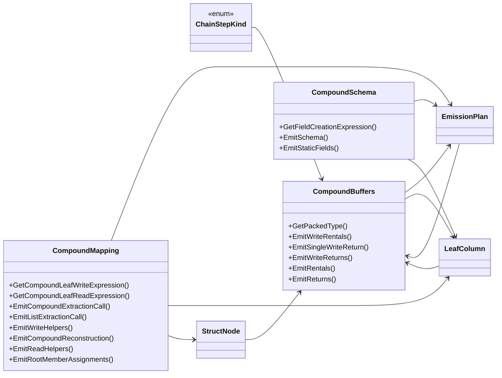

## ChainStepKind

**enum** · What a leaf column's member chain step contributes to the def ladder.

[LeafColumns.cs](https://github.com/rtkelly-labs/Parquet.SourceGenerator/blob/348590d5b72c/src/Parquet.SourceGenerator/Emitter/Compound/LeafColumns.cs) in src/Parquet.SourceGenerator/Emitter/Compound/ · 419 lines

## CompoundBuffers

**class** · Buffer rental/return lifecycle for models containing compound members.

[CompoundBuffers.cs](https://github.com/rtkelly-labs/Parquet.SourceGenerator/blob/348590d5b72c/src/Parquet.SourceGenerator/Emitter/Compound/CompoundBuffers.cs) in src/Parquet.SourceGenerator/Emitter/Compound/ · 289 lines

Public: `GetPackedType()`, `EmitWriteRentals()`, `EmitSingleWriteReturn()`, `EmitWriteReturns()`, `EmitRentals()`, `EmitReturns()`

## CompoundMapping

**class** · Compound write extraction and read reconstruction for the v6 emitter (issue #176 M2).

[CompoundMapping.cs](https://github.com/rtkelly-labs/Parquet.SourceGenerator/blob/348590d5b72c/src/Parquet.SourceGenerator/Emitter/Compound/CompoundMapping.cs) in src/Parquet.SourceGenerator/Emitter/Compound/ · 872 lines

Public: `GetCompoundLeafWriteExpression()`, `GetCompoundLeafReadExpression()`, `EmitCompoundExtractionCall()`, `EmitListExtractionCall()`, `EmitWriteHelpers()`, `EmitCompoundReconstruction()`, `EmitReadHelpers()`, `EmitRootMemberAssignments()`

## CompoundSchema

**class** · Schema and static-field emission for compound models: StructField recursion in the schema, and one cached DataField per leaf column reached through the StructField cast chain.

[CompoundSchema.cs](https://github.com/rtkelly-labs/Parquet.SourceGenerator/blob/348590d5b72c/src/Parquet.SourceGenerator/Emitter/Compound/CompoundSchema.cs) in src/Parquet.SourceGenerator/Emitter/Compound/ · 85 lines

Public: `GetFieldCreationExpression()`, `EmitSchema()`, `EmitStaticFields()`

## EmissionPlan

**class** · The flattened column plan + struct reconstruction tree for one model.

[LeafColumns.cs](https://github.com/rtkelly-labs/Parquet.SourceGenerator/blob/348590d5b72c/src/Parquet.SourceGenerator/Emitter/Compound/LeafColumns.cs) in src/Parquet.SourceGenerator/Emitter/Compound/ · 419 lines

## LeafColumn

**class** · One leaf column of the flattened emission plan.

[LeafColumns.cs](https://github.com/rtkelly-labs/Parquet.SourceGenerator/blob/348590d5b72c/src/Parquet.SourceGenerator/Emitter/Compound/LeafColumns.cs) in src/Parquet.SourceGenerator/Emitter/Compound/ · 419 lines

## StructNode

**class** · A struct node to reconstruct per row group on the read path.

[LeafColumns.cs](https://github.com/rtkelly-labs/Parquet.SourceGenerator/blob/348590d5b72c/src/Parquet.SourceGenerator/Emitter/Compound/LeafColumns.cs) in src/Parquet.SourceGenerator/Emitter/Compound/ · 419 lines
