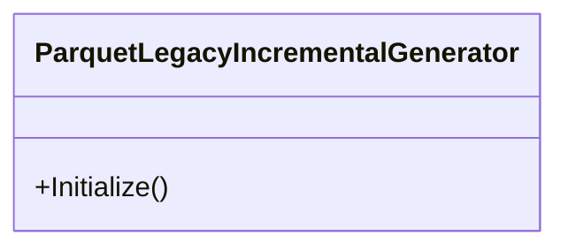

## ParquetLegacyIncrementalGenerator

**class** · Roslyn 4.0 Incremental Source Generator for Parquet.Net v4 / v5 (DataColumn-based API).

[ParquetLegacyIncrementalGenerator.cs](https://github.com/rtkelly-labs/Parquet.SourceGenerator/blob/348590d5b72c/src/Parquet.SourceGenerator.Legacy/ParquetLegacyIncrementalGenerator.cs) in src/Parquet.SourceGenerator.Legacy/ · 84 lines

Public: `Initialize()`
