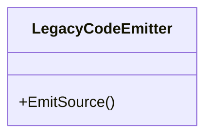

## LegacyCodeEmitter

**class** · Emits C# extension classes targeting Parquet.Net v4 / v5 (DataColumn-based API).

[LegacyCodeEmitter.cs](https://github.com/rtkelly-labs/Parquet.SourceGenerator/blob/348590d5b72c/src/Parquet.SourceGenerator.Legacy/Emitter/LegacyCodeEmitter.cs) in src/Parquet.SourceGenerator.Legacy/Emitter/ · 1005 lines

Public: `EmitSource()`
