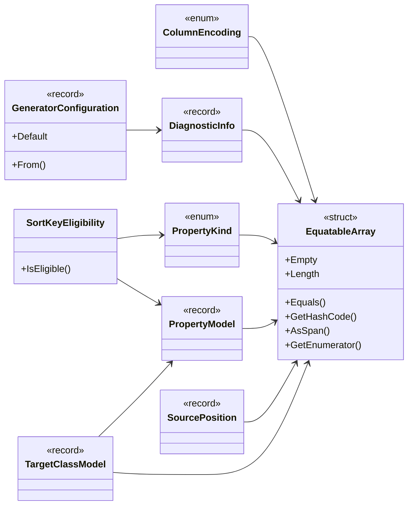

## ColumnEncoding

**enum** · Specifies the physical column encoding hint for code generation.

[PropertyModel.cs](https://github.com/rtkelly-labs/Parquet.SourceGenerator/blob/348590d5b72c/src/Parquet.SourceGenerator/Models/PropertyModel.cs) in src/Parquet.SourceGenerator/Models/ · 146 lines

## DiagnosticInfo

**record** · Value-equatable model representing a Roslyn diagnostic for incremental pipeline caching.

[DiagnosticInfo.cs](https://github.com/rtkelly-labs/Parquet.SourceGenerator/blob/348590d5b72c/src/Parquet.SourceGenerator/Models/DiagnosticInfo.cs) in src/Parquet.SourceGenerator/Models/ · 81 lines

## EquatableArray

**struct** · Immutable, value-equatable array wrapper designed for Roslyn incremental generator caching.

[EquatableArray.cs](https://github.com/rtkelly-labs/Parquet.SourceGenerator/blob/348590d5b72c/src/Parquet.SourceGenerator/Models/EquatableArray.cs) in src/Parquet.SourceGenerator/Models/ · 106 lines

Public: `Empty`, `Length`, `Equals()`, `GetHashCode()`, `AsSpan()`, `GetEnumerator()`

## GeneratorConfiguration

**record** · Value-equatable project configuration carried through the incremental pipeline.

[GeneratorConfiguration.cs](https://github.com/rtkelly-labs/Parquet.SourceGenerator/blob/348590d5b72c/src/Parquet.SourceGenerator/Models/GeneratorConfiguration.cs) in src/Parquet.SourceGenerator/Models/ · 68 lines

Public: `Default`, `From()`

## PropertyKind

**enum**

[PropertyModel.cs](https://github.com/rtkelly-labs/Parquet.SourceGenerator/blob/348590d5b72c/src/Parquet.SourceGenerator/Models/PropertyModel.cs) in src/Parquet.SourceGenerator/Models/ · 146 lines

## PropertyModel

**record** · Value-equatable model representing a single property or field binding.

[PropertyModel.cs](https://github.com/rtkelly-labs/Parquet.SourceGenerator/blob/348590d5b72c/src/Parquet.SourceGenerator/Models/PropertyModel.cs) in src/Parquet.SourceGenerator/Models/ · 146 lines

## SortKeyEligibility

**class** · Decides whether a root member can drive sorted row-group pruning (issue #151), and says why not when it cannot.

[SortKeyEligibility.cs](https://github.com/rtkelly-labs/Parquet.SourceGenerator/blob/348590d5b72c/src/Parquet.SourceGenerator/Models/SortKeyEligibility.cs) in src/Parquet.SourceGenerator/Models/ · 97 lines

Public: `IsEligible()`

## SourcePosition

**record** · A source position held as plain data, so a diagnostic can sit in a cached pipeline value without holding a Location (and through it the SyntaxTree).

[DiagnosticInfo.cs](https://github.com/rtkelly-labs/Parquet.SourceGenerator/blob/348590d5b72c/src/Parquet.SourceGenerator/Models/DiagnosticInfo.cs) in src/Parquet.SourceGenerator/Models/ · 81 lines

## TargetClassModel

**record** · Value-equatable model representing a class, record, or struct marked for Parquet code generation.

[TargetClassModel.cs](https://github.com/rtkelly-labs/Parquet.SourceGenerator/blob/348590d5b72c/src/Parquet.SourceGenerator/Models/TargetClassModel.cs) in src/Parquet.SourceGenerator/Models/ · 21 lines
