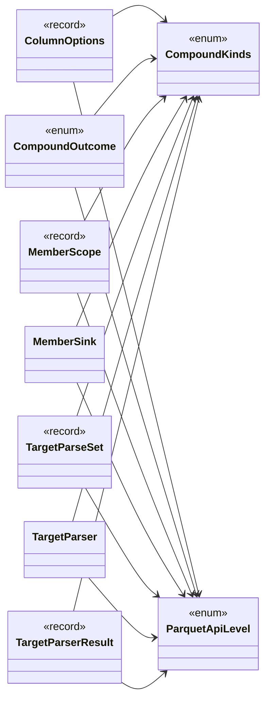

## ColumnOptions

**record** · The column shape resolved from [ParquetColumn] and the System.Text.Json equivalents, plus the [ParquetSortKey] opt-in carried alongside it.

[TargetParser.cs](https://github.com/rtkelly-labs/Parquet.SourceGenerator/blob/348590d5b72c/src/Parquet.SourceGenerator/Parser/TargetParser.cs) in src/Parquet.SourceGenerator/Parser/ · 2440 lines

## CompoundKinds

**enum** · Which compound member kinds the consuming emitter can express today.

[CompoundKinds.cs](https://github.com/rtkelly-labs/Parquet.SourceGenerator/blob/348590d5b72c/src/Parquet.SourceGenerator/Parser/CompoundKinds.cs) in src/Parquet.SourceGenerator/Parser/ · 32 lines

## CompoundOutcome

**enum** · Outcome of attempting to expand a leaf-classification failure into a compound member.

[TargetParser.cs](https://github.com/rtkelly-labs/Parquet.SourceGenerator/blob/348590d5b72c/src/Parquet.SourceGenerator/Parser/TargetParser.cs) in src/Parquet.SourceGenerator/Parser/ · 2440 lines

## MemberScope

**record** · The per-target context CollectMembers reads: identical for every member of one type, and rebuilt per compound child so the containment path and depth stay path-relative.

[TargetParser.cs](https://github.com/rtkelly-labs/Parquet.SourceGenerator/blob/348590d5b72c/src/Parquet.SourceGenerator/Parser/TargetParser.cs) in src/Parquet.SourceGenerator/Parser/ · 2440 lines

## MemberSink

**class** · Per-type collection state: the columns found so far, the names claimed so far, and the rejection flag the caller needs for PARQ003 suppression.

[TargetParser.cs](https://github.com/rtkelly-labs/Parquet.SourceGenerator/blob/348590d5b72c/src/Parquet.SourceGenerator/Parser/TargetParser.cs) in src/Parquet.SourceGenerator/Parser/ · 2440 lines

## ParquetApiLevel

**enum** · Which generation of the Parquet.Net API a backend emits against.

[ParquetApiLevel.cs](https://github.com/rtkelly-labs/Parquet.SourceGenerator/blob/348590d5b72c/src/Parquet.SourceGenerator/Parser/ParquetApiLevel.cs) in src/Parquet.SourceGenerator/Parser/ · 24 lines

## TargetParseSet

**record** · A target parsed under both dials: the compound one the feature level normally selects, and the flat one Level1Flat selects.

[TargetParser.cs](https://github.com/rtkelly-labs/Parquet.SourceGenerator/blob/348590d5b72c/src/Parquet.SourceGenerator/Parser/TargetParser.cs) in src/Parquet.SourceGenerator/Parser/ · 2440 lines

## TargetParser

**class** · Extracts semantic models from Roslyn syntax contexts for decorated target types and validates compiler rules.

[TargetParser.cs](https://github.com/rtkelly-labs/Parquet.SourceGenerator/blob/348590d5b72c/src/Parquet.SourceGenerator/Parser/TargetParser.cs) in src/Parquet.SourceGenerator/Parser/ · 2440 lines

## TargetParserResult

**record** · Result container holding parsed target model and pipeline diagnostics.

[TargetParser.cs](https://github.com/rtkelly-labs/Parquet.SourceGenerator/blob/348590d5b72c/src/Parquet.SourceGenerator/Parser/TargetParser.cs) in src/Parquet.SourceGenerator/Parser/ · 2440 lines
