```mermaid
classDiagram
direction LR
class FooterScanner
class NullableColumnExtractor {
  +ExtractBranchless()
  +ExtractTwoPass()
  +ExpandPresenceToDefinitionLevels()
  +CountPresent()
  +CompactInPlace()
}
class PageHeaderReader
class ParquetColumnAttribute
class ParquetColumnEncoding {
  <<enum>>
}
class ParquetColumnStatistics {
  <<struct>>
  +HasMinMax
  +Min
  +Max
  +NullCount
  +DistinctCount
  +IsKnownNonNull
  +MayContain()
  +MayContainAtLeast()
}
class ParquetCompressionLevel {
  <<enum>>
}
class ParquetCompressionMethod {
  <<enum>>
}
class ParquetDecimalAttribute {
  +Precision
  +Scale
}
class ParquetDecimalScale {
  +RestoreIntegerScaled()
}
class ParquetDecompressionGuardStream
class ParquetIgnoreAttribute
class ParquetPruneStatistics {
  +RowGroupCount
  +RowGroupsScanned
  +SortedColumnDetected
  +StrictlyMonotonic
  +FirstRowGroupRead
  +LastRowGroupRead
  +RowGroupsPruned
  +Reset()
}
class ParquetSerializableAttribute
class ParquetSerializerOptions
class ParquetSortKeyAttribute
class ParquetTimestampAttribute
class ParquetTimestampUnit {
  <<enum>>
}
class StringDeduplicator {
  <<struct>>
  +Deduplicate()
  +GetOrAdd()
  +Dispose()
}
class VectorizedColumnTransforms {
  +UnixEpochTicks
  +UtcEpochConstant
  +ConvertEpochMicrosecondsToTicks()
  +ConvertEpochMicrosecondsToDateTime()
  +ConvertTicksToEpochMicroseconds()
  +ConvertDateTimeToEpochMicroseconds()
  +ConvertEpochMillisecondsToTicks()
  +ConvertEpochMillisecondsToDateTime()
}
ParquetCompressionLevel --> ParquetColumnEncoding
ParquetCompressionMethod --> ParquetColumnEncoding
ParquetSerializerOptions --> ParquetColumnEncoding
click NullableColumnExtractor href "https://github.com/rtkelly-labs/Parquet.SourceGenerator/blob/348590d5b72c/src/Parquet.SourceGenerator.Runtime/NullableColumnExtractor.cs"
click ParquetColumnAttribute href "https://github.com/rtkelly-labs/Parquet.SourceGenerator/blob/348590d5b72c/src/Parquet.SourceGenerator.Runtime/ParquetColumnAttribute.cs"
click ParquetColumnEncoding href "https://github.com/rtkelly-labs/Parquet.SourceGenerator/blob/348590d5b72c/src/Parquet.SourceGenerator.Runtime/ParquetColumnAttribute.cs"
click ParquetColumnStatistics href "https://github.com/rtkelly-labs/Parquet.SourceGenerator/blob/348590d5b72c/src/Parquet.SourceGenerator.Runtime/ParquetColumnStatistics.cs"
click ParquetDecimalAttribute href "https://github.com/rtkelly-labs/Parquet.SourceGenerator/blob/348590d5b72c/src/Parquet.SourceGenerator.Runtime/ParquetDecimalAttribute.cs"
click ParquetDecimalScale href "https://github.com/rtkelly-labs/Parquet.SourceGenerator/blob/348590d5b72c/src/Parquet.SourceGenerator.Runtime/ParquetDecimalScale.cs"
click FooterScanner href "https://github.com/rtkelly-labs/Parquet.SourceGenerator/blob/348590d5b72c/src/Parquet.SourceGenerator.Runtime/ParquetDecompressionGuardStream.cs"
click PageHeaderReader href "https://github.com/rtkelly-labs/Parquet.SourceGenerator/blob/348590d5b72c/src/Parquet.SourceGenerator.Runtime/ParquetDecompressionGuardStream.cs"
click ParquetDecompressionGuardStream href "https://github.com/rtkelly-labs/Parquet.SourceGenerator/blob/348590d5b72c/src/Parquet.SourceGenerator.Runtime/ParquetDecompressionGuardStream.cs"
click ParquetIgnoreAttribute href "https://github.com/rtkelly-labs/Parquet.SourceGenerator/blob/348590d5b72c/src/Parquet.SourceGenerator.Runtime/ParquetIgnoreAttribute.cs"
click ParquetPruneStatistics href "https://github.com/rtkelly-labs/Parquet.SourceGenerator/blob/348590d5b72c/src/Parquet.SourceGenerator.Runtime/ParquetPruneStatistics.cs"
click ParquetSerializableAttribute href "https://github.com/rtkelly-labs/Parquet.SourceGenerator/blob/348590d5b72c/src/Parquet.SourceGenerator.Runtime/ParquetSerializableAttribute.cs"
click ParquetCompressionLevel href "https://github.com/rtkelly-labs/Parquet.SourceGenerator/blob/348590d5b72c/src/Parquet.SourceGenerator.Runtime/ParquetSerializerOptions.cs"
click ParquetCompressionMethod href "https://github.com/rtkelly-labs/Parquet.SourceGenerator/blob/348590d5b72c/src/Parquet.SourceGenerator.Runtime/ParquetSerializerOptions.cs"
click ParquetSerializerOptions href "https://github.com/rtkelly-labs/Parquet.SourceGenerator/blob/348590d5b72c/src/Parquet.SourceGenerator.Runtime/ParquetSerializerOptions.cs"
click ParquetSortKeyAttribute href "https://github.com/rtkelly-labs/Parquet.SourceGenerator/blob/348590d5b72c/src/Parquet.SourceGenerator.Runtime/ParquetSortKeyAttribute.cs"
click ParquetTimestampAttribute href "https://github.com/rtkelly-labs/Parquet.SourceGenerator/blob/348590d5b72c/src/Parquet.SourceGenerator.Runtime/ParquetTimestampAttribute.cs"
click ParquetTimestampUnit href "https://github.com/rtkelly-labs/Parquet.SourceGenerator/blob/348590d5b72c/src/Parquet.SourceGenerator.Runtime/ParquetTimestampAttribute.cs"
click StringDeduplicator href "https://github.com/rtkelly-labs/Parquet.SourceGenerator/blob/348590d5b72c/src/Parquet.SourceGenerator.Runtime/StringDeduplicator.cs"
click VectorizedColumnTransforms href "https://github.com/rtkelly-labs/Parquet.SourceGenerator/blob/348590d5b72c/src/Parquet.SourceGenerator.Runtime/VectorizedColumnTransforms.cs"
```

## FooterScanner

**class** · Checks every list count and byte length in the footer against the bytes that remain, and the row group count against the configured maximum, before Parquet.Net parses it.

[ParquetDecompressionGuardStream.cs](https://github.com/rtkelly-labs/Parquet.SourceGenerator/blob/348590d5b72c/src/Parquet.SourceGenerator.Runtime/ParquetDecompressionGuardStream.cs) in src/Parquet.SourceGenerator.Runtime/ · 952 lines

## NullableColumnExtractor

**class** · Branchless and (where the hardware offers it) SIMD-accelerated construction of Parquet definition levels and packed non-null value buffers from nullable value columns (issue #145).

[NullableColumnExtractor.cs](https://github.com/rtkelly-labs/Parquet.SourceGenerator/blob/348590d5b72c/src/Parquet.SourceGenerator.Runtime/NullableColumnExtractor.cs) in src/Parquet.SourceGenerator.Runtime/ · 293 lines

Public: `ExtractBranchless()`, `ExtractTwoPass()`, `ExpandPresenceToDefinitionLevels()`, `CountPresent()`, `CompactInPlace()`

## PageHeaderReader

**class** · Reads the sizes out of a Thrift compact-protocol PageHeader with the same field-id, long-form and last-field-id rules as Parquet.Net, refusing anything it would decode differently.

[ParquetDecompressionGuardStream.cs](https://github.com/rtkelly-labs/Parquet.SourceGenerator/blob/348590d5b72c/src/Parquet.SourceGenerator.Runtime/ParquetDecompressionGuardStream.cs) in src/Parquet.SourceGenerator.Runtime/ · 952 lines

## ParquetColumnAttribute

**class**

[ParquetColumnAttribute.cs](https://github.com/rtkelly-labs/Parquet.SourceGenerator/blob/348590d5b72c/src/Parquet.SourceGenerator.Runtime/ParquetColumnAttribute.cs) in src/Parquet.SourceGenerator.Runtime/ · 105 lines

## ParquetColumnEncoding

**enum** · Specifies the physical column encoding hint to apply when serializing column data.

[ParquetColumnAttribute.cs](https://github.com/rtkelly-labs/Parquet.SourceGenerator/blob/348590d5b72c/src/Parquet.SourceGenerator.Runtime/ParquetColumnAttribute.cs) in src/Parquet.SourceGenerator.Runtime/ · 105 lines

## ParquetColumnStatistics

**struct** · Projects the loosely typed MinValue / MaxValue objects Parquet.Net hands back onto the CLR type of a generated model property.

[ParquetColumnStatistics.cs](https://github.com/rtkelly-labs/Parquet.SourceGenerator/blob/348590d5b72c/src/Parquet.SourceGenerator.Runtime/ParquetColumnStatistics.cs) in src/Parquet.SourceGenerator.Runtime/ · 256 lines

Public: `HasMinMax`, `Min`, `Max`, `NullCount`, `DistinctCount`, `IsKnownNonNull`, `MayContain()`, `MayContainAtLeast()`

## ParquetCompressionLevel

**enum** · Specifies how hard the chosen compression method should work.

[ParquetSerializerOptions.cs](https://github.com/rtkelly-labs/Parquet.SourceGenerator/blob/348590d5b72c/src/Parquet.SourceGenerator.Runtime/ParquetSerializerOptions.cs) in src/Parquet.SourceGenerator.Runtime/ · 256 lines

## ParquetCompressionMethod

**enum** · Specifies compression method for Parquet serialization.

[ParquetSerializerOptions.cs](https://github.com/rtkelly-labs/Parquet.SourceGenerator/blob/348590d5b72c/src/Parquet.SourceGenerator.Runtime/ParquetSerializerOptions.cs) in src/Parquet.SourceGenerator.Runtime/ · 256 lines

## ParquetDecimalAttribute

**class**

[ParquetDecimalAttribute.cs](https://github.com/rtkelly-labs/Parquet.SourceGenerator/blob/348590d5b72c/src/Parquet.SourceGenerator.Runtime/ParquetDecimalAttribute.cs) in src/Parquet.SourceGenerator.Runtime/ · 35 lines

Public: `Precision`, `Scale`

## ParquetDecimalScale

**class** · Restores INT32- and INT64-backed Parquet decimals to their exact value after Parquet.Net has decoded them.

[ParquetDecimalScale.cs](https://github.com/rtkelly-labs/Parquet.SourceGenerator/blob/348590d5b72c/src/Parquet.SourceGenerator.Runtime/ParquetDecimalScale.cs) in src/Parquet.SourceGenerator.Runtime/ · 132 lines

Public: `RestoreIntegerScaled()`

## ParquetDecompressionGuardStream

**class** · Seekable read wrapper that validates each page header before Parquet.Net reads or decompresses its payload.

[ParquetDecompressionGuardStream.cs](https://github.com/rtkelly-labs/Parquet.SourceGenerator/blob/348590d5b72c/src/Parquet.SourceGenerator.Runtime/ParquetDecompressionGuardStream.cs) in src/Parquet.SourceGenerator.Runtime/ · 952 lines

## ParquetIgnoreAttribute

**class**

[ParquetIgnoreAttribute.cs](https://github.com/rtkelly-labs/Parquet.SourceGenerator/blob/348590d5b72c/src/Parquet.SourceGenerator.Runtime/ParquetIgnoreAttribute.cs) in src/Parquet.SourceGenerator.Runtime/ · 13 lines

## ParquetPruneStatistics

**class**

[ParquetPruneStatistics.cs](https://github.com/rtkelly-labs/Parquet.SourceGenerator/blob/348590d5b72c/src/Parquet.SourceGenerator.Runtime/ParquetPruneStatistics.cs) in src/Parquet.SourceGenerator.Runtime/ · 54 lines

Public: `RowGroupCount`, `RowGroupsScanned`, `SortedColumnDetected`, `StrictlyMonotonic`, `FirstRowGroupRead`, `LastRowGroupRead`, `RowGroupsPruned`, `Reset()`

## ParquetSerializableAttribute

**class**

[ParquetSerializableAttribute.cs](https://github.com/rtkelly-labs/Parquet.SourceGenerator/blob/348590d5b72c/src/Parquet.SourceGenerator.Runtime/ParquetSerializableAttribute.cs) in src/Parquet.SourceGenerator.Runtime/ · 19 lines

## ParquetSerializerOptions

**class** · Configurable options for Parquet source generator serialization and deserialization operations.

[ParquetSerializerOptions.cs](https://github.com/rtkelly-labs/Parquet.SourceGenerator/blob/348590d5b72c/src/Parquet.SourceGenerator.Runtime/ParquetSerializerOptions.cs) in src/Parquet.SourceGenerator.Runtime/ · 256 lines

## ParquetSortKeyAttribute

**class**

[ParquetSortKeyAttribute.cs](https://github.com/rtkelly-labs/Parquet.SourceGenerator/blob/348590d5b72c/src/Parquet.SourceGenerator.Runtime/ParquetSortKeyAttribute.cs) in src/Parquet.SourceGenerator.Runtime/ · 29 lines

## ParquetTimestampAttribute

**class**

[ParquetTimestampAttribute.cs](https://github.com/rtkelly-labs/Parquet.SourceGenerator/blob/348590d5b72c/src/Parquet.SourceGenerator.Runtime/ParquetTimestampAttribute.cs) in src/Parquet.SourceGenerator.Runtime/ · 57 lines

## ParquetTimestampUnit

**enum** · Specifies timestamp unit resolution for DateTime fields.

[ParquetTimestampAttribute.cs](https://github.com/rtkelly-labs/Parquet.SourceGenerator/blob/348590d5b72c/src/Parquet.SourceGenerator.Runtime/ParquetTimestampAttribute.cs) in src/Parquet.SourceGenerator.Runtime/ · 57 lines

## StringDeduplicator

**struct** · Lightweight L1 string cache keyed directly on ReadOnlySpan{T} of char, backed by a pooled open-addressed table.

[StringDeduplicator.cs](https://github.com/rtkelly-labs/Parquet.SourceGenerator/blob/348590d5b72c/src/Parquet.SourceGenerator.Runtime/StringDeduplicator.cs) in src/Parquet.SourceGenerator.Runtime/ · 182 lines

Public: `Deduplicate()`, `GetOrAdd()`, `Dispose()`

## VectorizedColumnTransforms

**class** · Hardware-accelerated (SIMD) column transformation utilities for Parquet column arithmetic, timestamp conversions, numeric scaling, and integer widening/narrowing.

[VectorizedColumnTransforms.cs](https://github.com/rtkelly-labs/Parquet.SourceGenerator/blob/348590d5b72c/src/Parquet.SourceGenerator.Runtime/VectorizedColumnTransforms.cs) in src/Parquet.SourceGenerator.Runtime/ · 641 lines

Public: `UnixEpochTicks`, `UtcEpochConstant`, `ConvertEpochMicrosecondsToTicks()`, `ConvertEpochMicrosecondsToDateTime()`, `ConvertTicksToEpochMicroseconds()`, `ConvertDateTimeToEpochMicroseconds()`, `ConvertEpochMillisecondsToTicks()`, `ConvertEpochMillisecondsToDateTime()`
