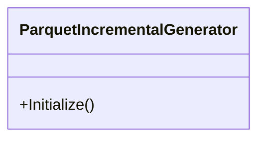

## ParquetIncrementalGenerator

**class** · Roslyn 4.0 Incremental Source Generator for Parquet.Net.

[ParquetIncrementalGenerator.cs](https://github.com/rtkelly-labs/Parquet.SourceGenerator/blob/348590d5b72c/src/Parquet.SourceGenerator/ParquetIncrementalGenerator.cs) in src/Parquet.SourceGenerator/ · 166 lines

Public: `Initialize()`
