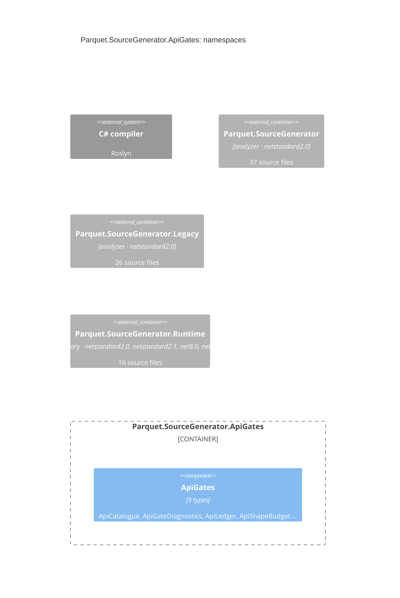

## ns_apigates

`Parquet.SourceGenerator.ApiGates`: 9 types in 7 files, 1801 lines, in tools/Parquet.SourceGenerator.ApiGates/

| File | Also declares | Lines |
|---|---|---|
| `ApiCatalogue.cs` |  | 88 |
| `ApiGateDiagnostics.cs` |  | 45 |
| `ApiLedger.cs` |  | 177 |
| `GeneratedApiBaseline.cs` |  | 672 |
| `GeneratedApiBudgetGate.cs` | ApiShapeBudget, ApiShapeMeasurement | 333 |
| `InternalSeamGateAnalyzer.cs` |  | 212 |
| `SeamSignature.cs` |  | 274 |

## sourcegenerator

See [its namespaces](/components/sourcegenerator.md).

## legacy

See [its namespaces](/components/legacy.md).

## runtime

See [its namespaces](/components/runtime.md).

## Derivation

Two pathways, scored against each other:

- **Both** type references and the call graph: 0 relationships.
- **Type references only** (mentions, signatures, or calls the graph could not resolve): none.
- **Call graph only** (a call with no type named, e.g. a static helper): none.
