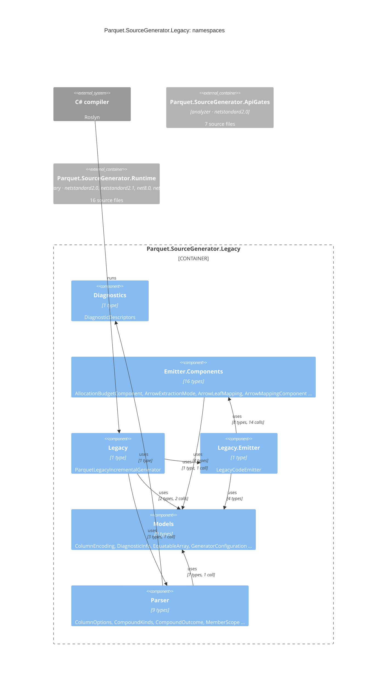

## ns_diagnostics

`Parquet.SourceGenerator.Diagnostics`: 1 type in 1 file, 331 lines, in src/Parquet.SourceGenerator/Diagnostics/

| File | Also declares | Lines |
|---|---|---|
| `DiagnosticDescriptors.cs` |  | 331 |

## ns_emitter_components

`Parquet.SourceGenerator.Emitter.Components`: 16 types in 12 files, 2381 lines, in src/Parquet.SourceGenerator/Emitter/Components/

| File | Also declares | Lines |
|---|---|---|
| `AllocationBudgetComponent.cs` |  | 103 |
| `ArrowMappingComponent.cs` | ArrowExtractionMode, ArrowLeafMapping | 327 |
| `BatchValidationComponent.cs` |  | 28 |
| `BufferPoolComponent.cs` |  | 311 |
| `DecompressionGuardComponent.cs` |  | 18 |
| `DictionaryPageComponent.cs` |  | 157 |
| `EmittedText.cs` |  | 63 |
| `IndentedWriter.cs` | BlockScope, IndentScope | 129 |
| `PropertyMappingComponent.cs` |  | 367 |
| `RowGroupLayoutComponent.cs` |  | 138 |
| `SchemaComponent.cs` |  | 558 |
| `StringDeduplicatorComponent.cs` |  | 182 |

## ns_legacy

`Parquet.SourceGenerator.Legacy`: 1 type in 1 file, 84 lines, in src/Parquet.SourceGenerator.Legacy/

| File | Also declares | Lines |
|---|---|---|
| `ParquetLegacyIncrementalGenerator.cs` |  | 84 |

## ns_legacy_emitter

`Parquet.SourceGenerator.Legacy.Emitter`: 1 type in 1 file, 1005 lines, in src/Parquet.SourceGenerator.Legacy/Emitter/

| File | Also declares | Lines |
|---|---|---|
| `LegacyCodeEmitter.cs` |  | 1005 |

## ns_models

`Parquet.SourceGenerator.Models`: 9 types in 6 files, 519 lines, in src/Parquet.SourceGenerator/Models/

| File | Also declares | Lines |
|---|---|---|
| `DiagnosticInfo.cs` | SourcePosition | 81 |
| `EquatableArray.cs` |  | 106 |
| `GeneratorConfiguration.cs` |  | 68 |
| `PropertyModel.cs` | ColumnEncoding, PropertyKind | 146 |
| `SortKeyEligibility.cs` |  | 97 |
| `TargetClassModel.cs` |  | 21 |

## ns_parser

`Parquet.SourceGenerator.Parser`: 9 types in 3 files, 2496 lines, in src/Parquet.SourceGenerator/Parser/

| File | Also declares | Lines |
|---|---|---|
| `CompoundKinds.cs` |  | 32 |
| `ParquetApiLevel.cs` |  | 24 |
| `TargetParser.cs` | ColumnOptions, CompoundOutcome, MemberScope … | 2440 |

## apigates

See [its namespaces](/components/apigates.md).

## runtime

See [its namespaces](/components/runtime.md).

## Derivation

Two pathways, scored against each other:

- **Both** type references and the call graph: 5 relationships.
- **Type references only** (mentions, signatures, or calls the graph could not resolve): `ns_emitter_components → ns_models`, `ns_legacy_emitter → ns_models`, `ns_parser → ns_diagnostics`.
- **Call graph only** (a call with no type named, e.g. a static helper): none.
