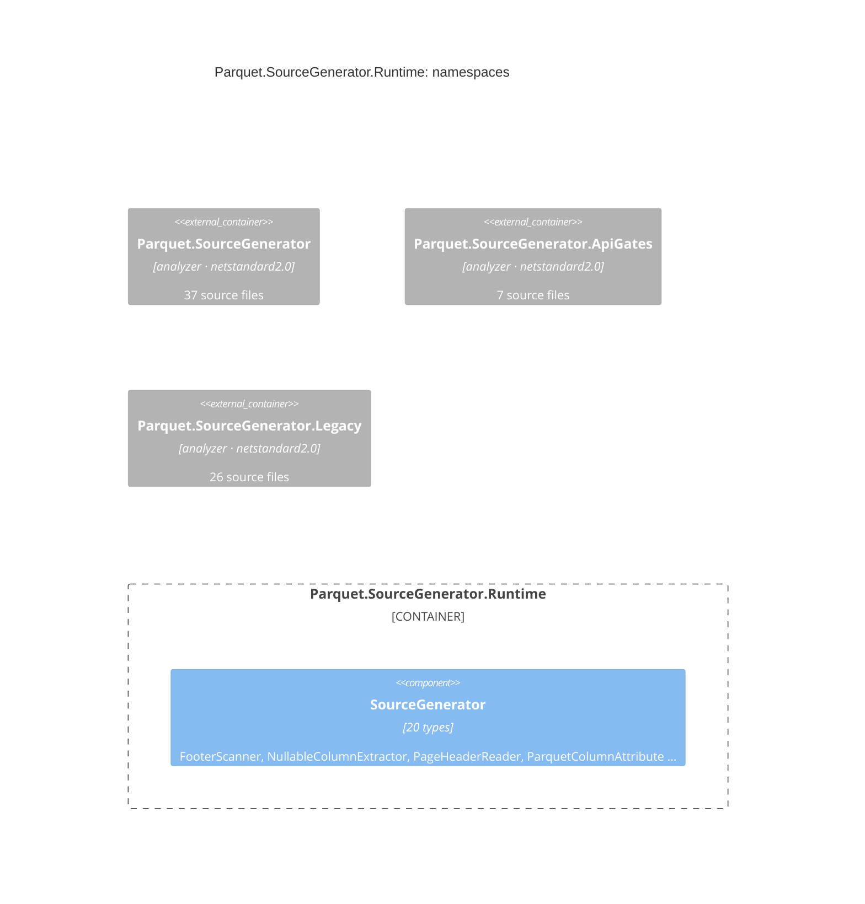

## ns_sourcegenerator_runtime

`Parquet.SourceGenerator`: 20 types in 14 files, 3024 lines, in src/Parquet.SourceGenerator.Runtime/

| File | Also declares | Lines |
|---|---|---|
| `NullableColumnExtractor.cs` |  | 293 |
| `ParquetColumnAttribute.cs` | ParquetColumnEncoding | 105 |
| `ParquetColumnStatistics.cs` |  | 256 |
| `ParquetDecimalAttribute.cs` |  | 35 |
| `ParquetDecimalScale.cs` |  | 132 |
| `ParquetDecompressionGuardStream.cs` | FooterScanner, PageHeaderReader | 952 |
| `ParquetIgnoreAttribute.cs` |  | 13 |
| `ParquetPruneStatistics.cs` |  | 54 |
| `ParquetSerializableAttribute.cs` |  | 19 |
| `ParquetSerializerOptions.cs` | ParquetCompressionLevel, ParquetCompressionMethod | 256 |
| `ParquetSortKeyAttribute.cs` |  | 29 |
| `ParquetTimestampAttribute.cs` | ParquetTimestampUnit | 57 |

And 2 more files.

## sourcegenerator

See [its namespaces](/components/sourcegenerator.md).

## apigates

See [its namespaces](/components/apigates.md).

## legacy

See [its namespaces](/components/legacy.md).

## Derivation

Two pathways, scored against each other:

- **Both** type references and the call graph: 0 relationships.
- **Type references only** (mentions, signatures, or calls the graph could not resolve): none.
- **Call graph only** (a call with no type named, e.g. a static helper): none.
