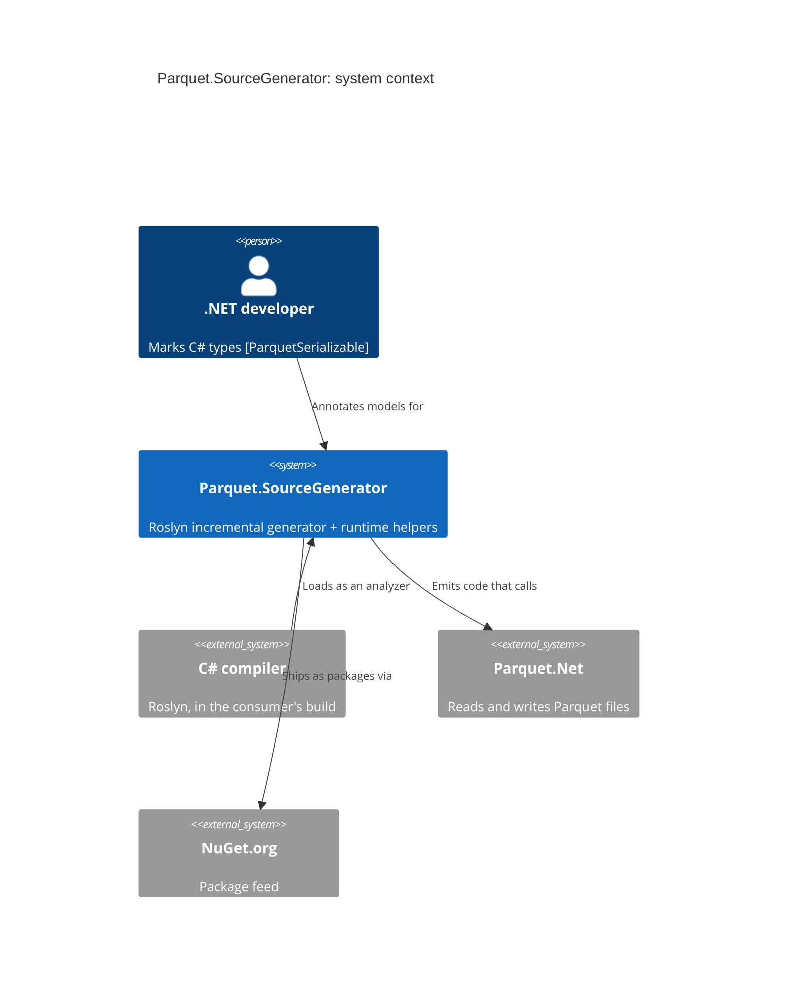

This view is the only hand-drawn one in the bundle. Everything below `psg` is written by
`rig c4 derive dotnet` from the repository's `.csproj` files and C# sources, so it can be regenerated and
checked for staleness. See [the projects](containers.md).

## psg

The generator runs **inside the consumer's compiler**: it is loaded as an analyzer, reads the annotated types
and emits `<Model>ParquetExtensions.g.cs`. Nothing of the generator itself ships in the consumer's
assemblies. The runtime package does: attributes plus the helpers the emitted code calls.

## parquetnet

Not a dependency of any project under `src/`. Only the *emitted* code calls Parquet.Net, which is why the
derived views cannot see this edge and it has to be drawn here.

## csc

The same alias appears in the derived container and component views, so `rig c4 model` merges them into one
element across three levels.
