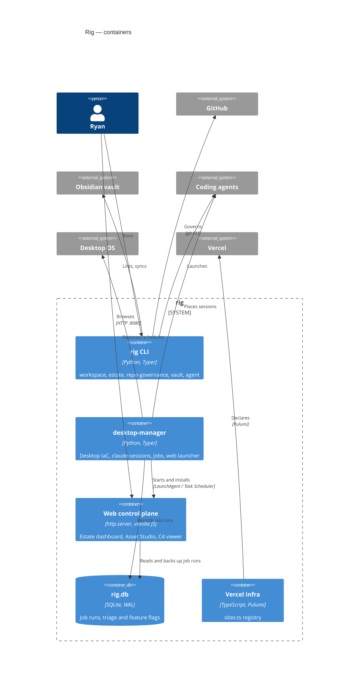

Two containers have no deeper view yet; `rig CLI` zooms into a plain note, which `rig c4 check` reports as an
information finding rather than an error.

## rig.db

Shared by the jobs runner and the dashboard. Its code-level view is linked from both component diagrams below:
one document composed into two views.
