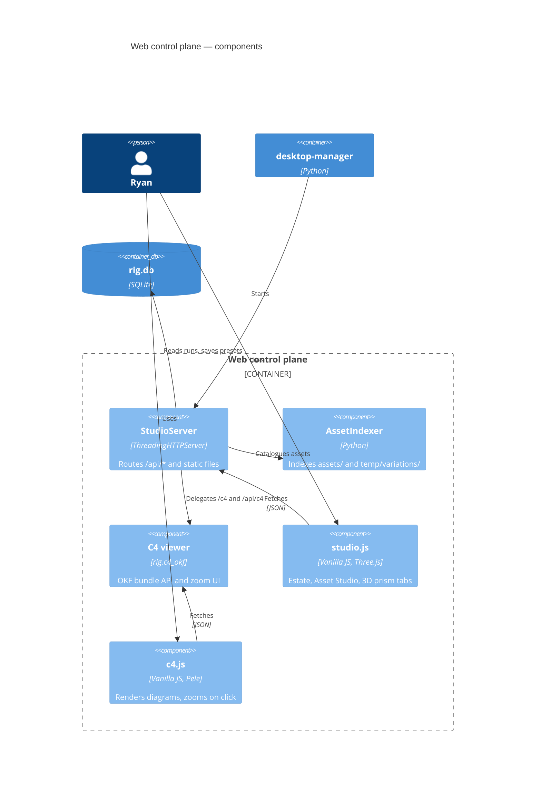

## C4 viewer

This experiment. The decision to render in the browser rather than in a Node process is recorded in
[no Node at runtime](decisions/no-node-at-runtime.md).

## StudioServer

`server.py` sits at the 800-line ratchet cap, which is why the C4 routes live in their own module and the server
only delegates to them.
