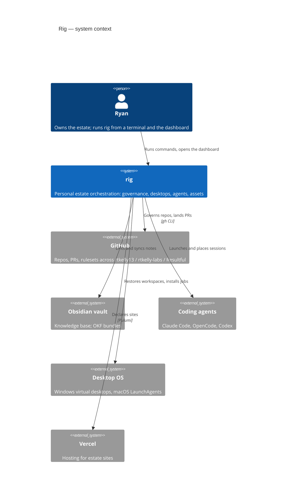

The root of this bundle. Click **rig** to zoom into its containers.

## rig

One Python repo (`uv`), several CLIs. Read [the container view](rig/containers.md) for the split. Governance
policy lives in the repo, not here: this bundle describes *shape*, not *rules*.

## GitHub

Every push and merge is checked against the remote owner first; work credentials are live on the same machine.

## Coding agents

Agents are launched by `rig agent`, and their terminals are placed by `desktop-manager claude-sessions`.
