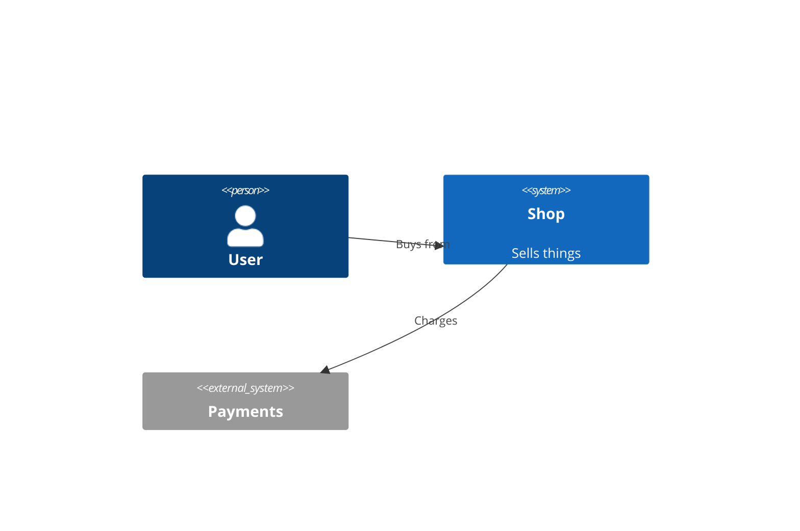

Intro with <b>raw html</b> & ampersand, "quotes", 'single', a [titled link](sub/cont.md "the title") and <script>alert(1)</script>.

| col a | col b | c |
|:--|--:|:-:|
| 1 | `two` | **3** |
| x<y | y&z | |

```python
def f():
    return "<tag>"
```

* item one
* item two
  1. nested

> quote line
> more

<div>block html</div>

Line one  
hard break and *emph* __strong__ and https://example.com bare and  and [js](javascript:alert(1)).

## shop

The thing we build. See [cont](sub/cont.md).

## `pay`

Payments note <i>x</i>.
